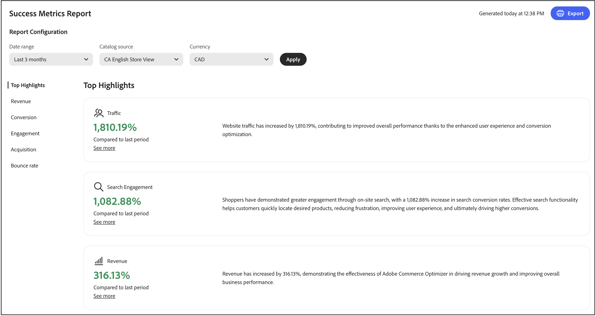
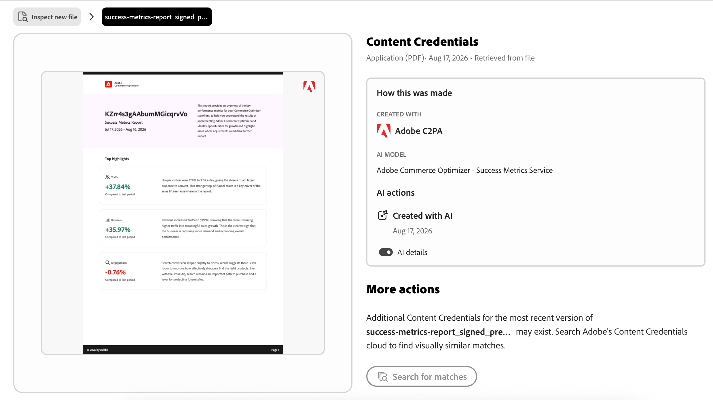
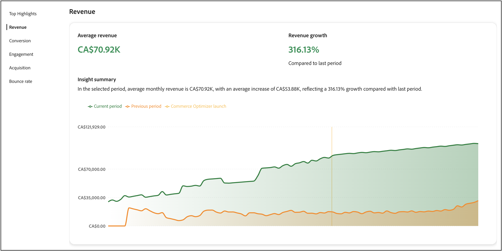
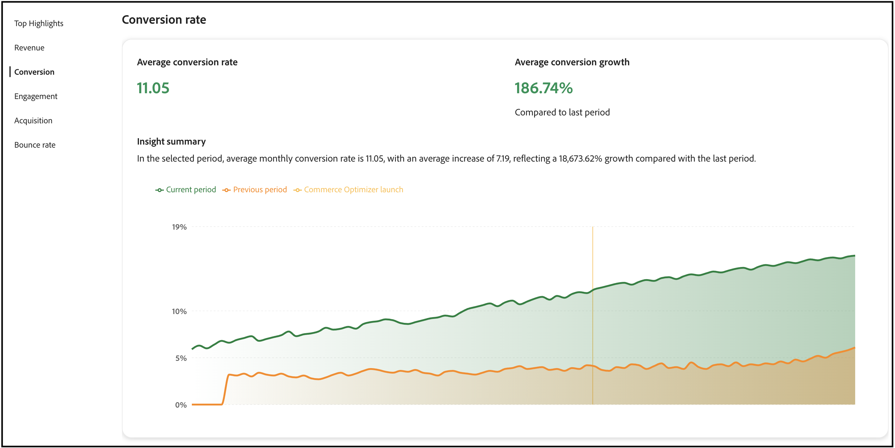
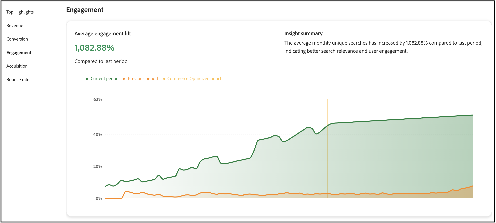
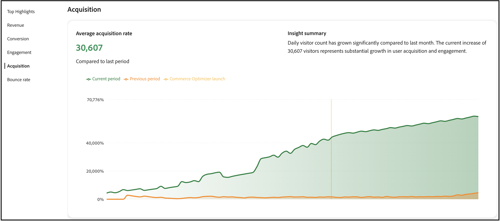
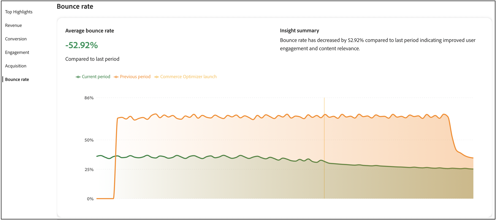

Cette page présente un aperçu des mesures de performances clés de votre boutique. L’objectif est de comprendre les résultats de la mise en œuvre des services de marchandisage avec le modèle de données de catalogue composable (CCDM) afin d’identifier les possibilités de croissance et les domaines à optimiser.



Les mesures du rapport sont extraites des données d’événement du storefront. [En savoir plus](../setup/events/overview.md) sur les données d&#39;événement collectées.

## Accès à l’espace de travail Mesures de succès

La façon dont vous ouvrez l’espace de travail *Mesures de succès* dépend du produit que vous utilisez :

- **Administrateur Adobe Commerce** (Adobe Commerce as a Cloud Service) : Sélectionnez *Rapports* > **Mesures De Succès**.
- **Adobe Commerce Optimizer Studio** : sélectionnez **Mesures de succès** dans le menu racine.

## Compréhension de vos mesures

Le rapport des mesures de succès fournit des informations exploitables sur cinq domaines de performances clés qui ont un impact direct sur les résultats de votre entreprise. Chaque mesure révèle des modèles de comportement des clients et des clientes, ainsi que des performances de magasin qui vous aident à découvrir des opportunités et à relever des défis. Tirez parti de ces informations pour prendre des décisions plus intelligentes et optimiser votre expérience commerciale.

**Principales caractéristiques** résume les mesures clés de chaque domaine de performance. Utilisez cette section pour identifier rapidement les principales opportunités d’amélioration.

Les principaux indicateurs de performance sont les suivants :

- **Chiffre d’affaires** : votre principale mesure financière montrant les performances des ventes totales.
- **Conversion** : pourcentage de visiteurs qui effectuent des achats.
- **Engagement** : niveau d’interaction des utilisateurs avec votre site.
- **Acquisition** : l’efficacité de vos efforts d’acquisition de clients.
- **Taux de rebond** : pourcentage de visiteurs qui quittent après avoir consulté une seule page.

### Actualisation et précision des données

**Fréquence de mise à jour :** les données de mesures de succès sont traitées et mises à jour régulièrement au fur et à mesure que les événements de storefront sont collectés et traités.

**Quand vérifier les mesures :** Pour l’analyse de tendance la plus précise, passez en revue les mesures après un délai suffisant pour collecter des données significatives. Les fluctuations quotidiennes sont normales ; concentrez-vous sur les tendances hebdomadaires ou mensuelles pour prendre des décisions stratégiques.

**Précision des données :** les mesures sont calculées à partir des interactions client réelles capturées par le biais d’événements de storefront. Assurez-vous que votre boutique dispose d’un [suivi des événements configuré](../setup/events/overview.md) approprié pour des rapports précis.

## Générer un rapport

1. Dans l’espace de travail **[!UICONTROL Success Metrics]**, sous **Configuration du rapport**, spécifiez la **Période**, la **Source du catalogue**, en fonction de vos paramètres régionaux, et la **Devise**.
1. Cliquez sur **[!UICONTROL Apply]**.

   Les **principaux points forts**, **Chiffre d’affaires**, **Conversion**, **Engagement**, **Acquisition** et **Taux de rebond** sont tous mis à jour en fonction de la configuration de votre rapport.

1. Cliquez sur **[!UICONTROL Export]** pour enregistrer le rapport en tant que PDF.

## Métadonnées C2PA sur les rapports exportés {#c2pa-metadata-on-exported-reports}

Le rapport Mesures de succès comprend des points forts et des résumés à l’aide de l’IA générative. Lorsque vous exportez un rapport vers PDF, Adobe joint automatiquement les métadonnées C2PA au fichier exporté.

Les métadonnées C2PA sont des métadonnées lisibles par machine et inviolables basées sur la norme ouverte [C2PA](https://c2pa.org/). Les enregistrements de métadonnées indiquent que le contenu du rapport a été créé avec l’IA générative, le modèle d’IA utilisé et la date de création.

>[!NOTE]
>
>Les métadonnées C2PA sont automatiquement jointes. Aucune action supplémentaire n’est requise et ce comportement ne peut pas être désactivé. Les métadonnées C2PA ne modifient pas l’aspect de votre rapport. Il s’agit de métadonnées invisibles transmises dans le PDF.

**Signification pour vos rapports exportés**

- Lorsque vous exportez un rapport de mesures de succès vers PDF, le fichier exporté transporte des métadonnées C2PA.
- Les métadonnées C2PA voyagent avec le PDF lorsque vous le partagez ou le téléchargez. Les plateformes tierces qui prennent en charge les métadonnées C2PA peuvent lire ces métadonnées et afficher des informations de transparence aux visiteurs.
- Vous pouvez vérifier les métadonnées C2PA jointes à n&#39;importe quel fichier en les chargeant dans [Inspect](https://contentauthenticity.adobe.com/inspect).



En savoir plus sur la [transparence du contenu de Generative AI](https://experienceleague.adobe.com/fr/docs/cx-enterprise-ai/experience-cloud-ai/overview/content-transparency).

## Utilisation conjointe des mesures de succès et de Sites Optimizer

Les mesures de succès et Sites Optimizer ([Opportunités](opportunities.md)) sont des outils complémentaires conçus pour fonctionner ensemble et vous aider à améliorer les performances de votre site de commerce. Comprendre la différence entre ces fonctionnalités vous aide à prendre de meilleures décisions et à obtenir des résultats mesurables.

### Principales différences

| Aspect | Mesures de succès | Sites Optimizer (opportunités) |
|---|---|---|
| **Objectif** | Mesure les performances et les résultats | identifie les problèmes et fournit des recommandations ; |
| **Type** | Tableau de bord analytique | Détection proactive des problèmes |
| **Ce qu&#39;elle affiche** | Indicateurs clés de performance (chiffre d’affaires, conversion, engagement, acquisition, taux de rebond) | Recommandations optimisées par l’IA pour les problèmes affectant les performances du site |
| **Source de données** | Données d’événement de storefront | Catalogues de produits, journaux de recherche, données de recommandation |
| **Utiliser quand** | Vous souhaitez suivre les résultats au fil du temps. | Vous souhaitez identifier et résoudre des problèmes spécifiques |

### Utilisation conjointe de ces fonctionnalités

L’approche la plus efficace consiste à combiner les deux outils dans un cycle d’amélioration continue :

1. **Mesurer avec des mesures de succès** : commencez par consulter votre tableau de bord de mesures de succès pour comprendre vos performances actuelles. Identifiez les KPI à améliorer (par exemple, un taux de conversion faible ou un taux de rebond élevé).

1. **Diagnostiquer avec des opportunités** : accédez à la page Opportunités pour découvrir des problèmes spécifiques qui peuvent entraîner de faibles performances. Sites Optimizer analyse votre catalogue de produits, vos journaux de recherche et vos données de recommandation afin d’identifier des problèmes tels que des données de produit manquantes, une faible pertinence de la recherche ou des problèmes de navigation.

1. **Implémenter des recommandations** : suivez les recommandations pilotées par l’IA fournies dans Opportunités de résoudre les problèmes détectés. Ces recommandations peuvent inclure la résolution des problèmes de qualité des données de produit, l’amélioration de l’optimisation du référencement ou l’optimisation de la recherche.

1. **Suivre les améliorations** : revenez aux mesures de succès pour surveiller l’impact des modifications sur vos indicateurs de performance clés au fil du temps. Utilisez le sélecteur de période pour comparer les performances avant et après l’implémentation des recommandations.

1. **Itérer et optimiser** : continuez ce cycle en utilisant les Opportunités pour identifier les nouveaux problèmes et les mesures de succès afin de mesurer l’impact de vos optimisations.

### Exemple de workflow

Un commerçant remarque que son taux de conversion diminue dans les mesures de succès. Voici comment ils peuvent utiliser les deux fonctionnalités pour y remédier :

1. **Identifier le problème** : le tableau de bord des mesures de succès indique une baisse de 15 % du taux de conversion au cours du dernier mois.

1. **Trouver la cause** : la page Opportunités révèle plusieurs problèmes :
   - Plusieurs produits ne possèdent pas d’attributs clés affectant la pertinence de la recherche.
   - Requêtes de recherche populaires renvoyant de mauvais résultats.
   - Temps de chargement de page lent sur les pages de catégorie.

1. **Agir** : le commerçant donne la priorité à la résolution des problèmes de qualité des données de produit, car Sites Optimizer les classe comme des opportunités à fort impact affectant la recherche et les recommandations.

1. **Mesurer les résultats** : après la mise à jour des attributs du produit et l’implémentation des modifications recommandées, le commerçant surveille les mesures de succès une fois par semaine. Au cours du mois suivant, le taux de conversion augmentera de 12 % et les mesures d’engagement dans la recherche s’amélioreront.

1. **Continuez l’optimisation** : avec l’amélioration du taux de conversion, le commerçant passe à la priorité suivante affichée dans Opportunités, à savoir l’optimisation de la vitesse de chargement des pages pour réduire le taux de rebond.

### Quand utiliser chaque fonctionnalité

**Utiliser des mesures de succès lorsque vous souhaitez :**

- Effectuez le suivi des performances globales de l’entreprise.
- Mesurez l’impact des modifications au fil du temps.
- Identifiez les domaines de votre entreprise qui nécessitent une attention particulière.
- Partagez les rapports de performance avec les parties prenantes.
- comprendre les tendances du comportement des clients ;

**Utilisez Sites Optimizer (Opportunités) lorsque vous souhaitez :**

- Identifiez les problèmes spécifiques affectant les performances.
- Obtenez des recommandations pratiques pour résoudre les problèmes.
- Comprendre pourquoi certaines mesures sont en baisse.
- Hiérarchisez les optimisations à traiter en premier.
- Utilisez l’IA pour identifier les problèmes que vous pouvez manquer manuellement.

Ensemble, ces fonctionnalités offrent une solution complète : les mesures de succès vous indiquent *ce qui se passe*, tandis que Sites Optimizer vous indique *pourquoi* et *comment corriger le problème*.

## Étapes suivantes et stratégies d’optimisation

Utilisez vos données de mesures de succès pour identifier les opportunités d’amélioration et mettre en œuvre des stratégies d’optimisation ciblées. Les sections suivantes fournissent des conseils spécifiques et exploitables pour chaque zone de mesure.

>[!BEGINTABS]

>[!TAB Optimisation du chiffre d’affaires]

Pour le chiffre d’affaires, votre objectif est d’augmenter les ventes totales et la valeur moyenne des commandes.



### Comprendre la mesure du chiffre d’affaires

**Ce qu&#39;il mesure :** Le revenu total généré par votre boutique pendant la période sélectionnée.

**Méthode de calcul :** Le chiffre d&#39;affaires est la somme de toutes les commandes terminées (prix de base × quantité) pour tous les produits vendus au cours de la période de déclaration. Le calcul utilise les données de `place-order` événements capturés sur votre storefront.

>[!IMPORTANT]
>
>Les calculs de chiffre d&#39;affaires excluent les commandes annulées, les retours et les commandes pour lesquels l&#39;événement `place-order` n&#39;a pas été capturé. Les événements peuvent être manquants en raison de paramètres de consentement, de problèmes de navigateur (bloqueurs de publicités, échecs de script) ou d’erreurs de traitement technique.

**Formule :**

```
Total Revenue = Sum of (Product Base Price × Quantity) for all completed orders
```

**Source de données :** événements Storefront (en particulier `place-order` événements)

**Éléments inclus :**

- Toutes les commandes terminées pendant la période sélectionnée.
- Prix des produits de base multipliés par les quantités achetées.
- Chiffre d’affaires de tous les canaux de vente soutenu par les services de marchandisage avec le CCDM.

**Remarques importantes :**

- Le chiffre d’affaires est calculé en fonction des prix de base capturés dans les événements de storefront.
- La période que vous sélectionnez dans la configuration du rapport détermine la période du rapport.
- Les mesures de chiffre d’affaires sont mises à jour à mesure que de nouveaux événements de commande sont traités.

### Stratégies

- **Implémentez des recommandations optimisées par l’IA** : utilisez le moteur de recommandation des services de marchandisage pour faire apparaître les produits pertinents qui génèrent des taux de conversion plus élevés. Déployer *Les clients qui ont consulté ceci ont également consulté* et *Acheté ceci, acheté cela* types de recommandations pour augmenter les opportunités de vente croisée.

- **Créer des règles de marchandisage** : améliorez les produits à marge élevée dans les résultats de recherche à l’aide de [règles de marchandisage](../merchandising/rules/overview.md). Épinglez les articles les plus vendus en haut des résultats de recherche pour les requêtes à trafic élevé.

- **Optimisez la découverte de produits** : utilisez [des facettes intelligentes](../merchandising/facets/overview.md) pour aider les clients à trouver des produits plus efficacement, ce qui entraîne des taux de conversion plus élevés et une augmentation des recettes.

- **Tirez parti des opportunités saisonnières** : créez des règles de marchandisage temporelles pour promouvoir les articles saisonniers ou promotionnels pendant les périodes de pointe des achats.

>[!TAB Amélioration du taux de conversion]

Pour améliorer votre taux de conversion, votre objectif est de convertir davantage de visiteurs en clients.



### Comprendre la mesure du taux de conversion

**Ce qu’il mesure :** pourcentage de visiteurs qui consultent des produits, puis effectuent un achat, ce qui indique l’efficacité avec laquelle votre boutique convertit les navigateurs en acheteurs.

**Méthode de calcul :** Le taux de conversion compare le nombre de visiteurs uniques qui ont acheté des produits au nombre de visiteurs uniques qui ont consulté des produits.

**Formule :**

```
Conversion Rate = (Total Number of Orders ÷ Total Unique Visitors) × 100
```

**Source de données :** événements Storefront.

**Fonctionnement :**

- **Les consultations de produits** sont suivies lorsque les visiteurs consultent les pages de produits (à l’aide de `product-view` événements).
- **Les achats** sont suivis une fois les commandes terminées (à l’aide de `place-order` événements).
- Le calcul fait correspondre les utilisateurs et utilisatrices qui ont consulté des produits spécifiques avec ceux qui les ont achetés.

**Remarques importantes :**

- Un visiteur qui consulte plusieurs produits mais effectue un seul achat compte comme une seule conversion.
- La mesure effectue le suivi des visiteurs uniques à l’aide d’identifiants de navigateur.
- Les événements de consultation de produit incluent toujours un clic, de sorte que les vues représentent un intérêt réel de l’utilisateur.

### Stratégies

- **Optimiser la pertinence de la recherche** : implémentez des [synonymes](../merchandising/synonyms/overview.md) pour vous assurer que les clients trouvent ce qu’ils recherchent, même avec des termes de recherche différents. Utilisez la facettisation dynamique pour fournir des options de filtrage pertinentes.

- **Emplacement de recommandation stratégique** : déployez des unités de recommandation sur les pages à trafic élevé, telles que les pages de détails de produit et les pages de catégorie. Utilisez les recommandations *Les plus consultées* et *Les plus achetées* pour établir la confiance et l’urgence.

- **Améliorez la visibilité des produits** : utilisez les règles de marchandisage pour vous assurer que les produits les plus vendus et à forte conversion apparaissent bien en vue dans les résultats de recherche.

- **Types de recommandations de test A/B** : testez différents types de recommandations et emplacements pour trouver celui qui convient le mieux à votre audience.

>[!TAB Amélioration de l’engagement]

Pour améliorer l’engagement, votre objectif est d’augmenter l’interaction client et le temps passé sur le site.



### Compréhension de la mesure d’engagement

**Ce qu’il mesure :** la façon dont les utilisateurs interagissent activement avec votre boutique, en suivant les actions significatives depuis la navigation initiale jusqu’au processus de paiement.

**Méthode de calcul :** l’engagement suit toutes les interactions qui indiquent une participation active à votre boutique, y compris la navigation dans les produits, les activités liées au panier et les actions de passage en caisse.

**Source de données :** événements Storefront

**Ce qui compte comme un engagement :**

L’engagement comprend les catégories d’événement et les actions suivantes :

- **Interactions de produits :** consultations de produits, clics de produits et comparaisons de produits.
- **Activités de panier :** Ajout d’articles au panier, mise à jour des quantités, suppression d’articles.
- **Actions de passage en caisse :** Lancement du passage en caisse, exécution des étapes de passage en caisse.
- **Navigation dans les catégories :** Affichage des pages de catégorie, filtrage par facettes.
- **Activités de liste de souhaits :** Ajout à la liste de souhaits, affichage des éléments de la liste de souhaits.

**Détails de suivi des événements :**

Le système effectue le suivi de l’engagement lorsque les événements ont :

- Catégorie : `product`, `shopper`, `shopping-cart` ou `checkout`.
- Propriété : `Product`, `Checkout`, `Cart`, `Category` ou `Wishlist`.

**Remarques importantes :**

- Un engagement plus important est généralement corrélé à des taux de conversion plus élevés.
- Les mesures d’engagement permettent d’identifier les utilisateurs les plus actifs dans leur parcours.
- Utilisez les données d’engagement pour optimiser les pages à trafic élevé et améliorer l’expérience client.

### Stratégies

- **Diversifier les types de recommandations** : évitez d’afficher les mêmes recommandations à plusieurs reprises. Utilisez un mélange de *Recommandé*, *En tendance* et *Récemment consultés* pour conserver le contenu frais et attrayant.

- **Implémentez une recherche intelligente** : utilisez la facettisation dynamique pilotée par l’IA et le reclassement des résultats pour adapter les résultats de recherche en temps réel en fonction du comportement de l’acheteur.

- **Création d’expériences personnalisées** : déployez des unités « Recommandé pour vous » sur la page d’accueil et sur l’ensemble du parcours client pour fournir des suggestions de produits personnalisées.

- **Optimiser l’expérience de recherche** : utilisez des synonymes pour améliorer la pertinence de la recherche et vous assurer que les clients trouvent rapidement ce qu’ils recherchent.

>[!TAB Croissance des acquisitions]

Pour augmenter votre croissance, vous avez pour objectif d&#39;attirer davantage de nouveaux clients et d&#39;améliorer l&#39;efficacité de vos acquisitions.



### Comprendre la mesure d’acquisition

**Ce qu’il mesure :** Le nombre de nouveaux visiteurs uniques qui viennent dans votre magasin, ce qui vous aide à comprendre l’efficacité de vos efforts de marketing et d’acquisition de clients.

**Méthode de calcul :** L’acquisition comptabilise les visiteurs uniques en fonction des identifiants de navigateur attribués lors de leur première visite dans votre boutique.

**Source de données :** événements Storefront.

**Fonctionnement :**

- Le navigateur de chaque visiteur reçoit un identifiant unique (`domain_userid`) via un cookie propriétaire.
- Les nouveaux visiteurs sont identifiés lorsque leur index de session est égal à 1 (première visite).
- Le système suit ces identifiants pour distinguer les nouveaux visiteurs des visiteurs récurrents.

**Remarques importantes :**

Cette méthode de suivi présente certaines limites connues :

- **Utilisateurs de plusieurs appareils :** Une même personne visitant à partir de différents appareils (ordinateur, mobile, tablette) ou navigateurs est comptabilisée comme plusieurs visiteurs uniques, car chaque appareil et navigateur reçoit un identifiant différent.
- **Effacement des cookies :** Les utilisateurs qui effacent les cookies de leur navigateur se voient attribuer un nouvel identifiant et sont de nouveau comptabilisés comme de nouveaux visiteurs.
- **Paramètres de confidentialité :** les utilisateurs dotés de paramètres de confidentialité stricts ou de bloqueurs de cookies peuvent ne pas être suivis.

**Idéal pour :**

- Suivi des nouvelles tendances des visiteurs au fil du temps.
- Analyse de l’efficacité des campagnes marketing.
- Comprendre les modèles de croissance du trafic.

**Conseil d’interprétation :** Bien qu’elles ne soient pas parfaitement exactes en raison des limitations ci-dessus, les mesures d’acquisition sont fiables pour identifier les tendances et comparer les périodes pendant lesquelles la plupart des utilisateurs naviguent sur le même appareil et n’effacent pas fréquemment les cookies.

### Stratégies

- **Exploiter les données de performances de recherche** : utilisez le rapport [performances de recherche](../manage-results/search-performance.md) pour identifier les produits en tendance et les termes de recherche populaires. Créez des règles de marchandisage pour mettre en évidence ces éléments.

- **Optimiser les performances des recommandations** : surveillez les mesures de [performances des recommandations](../manage-results/recommendation-performance.md) afin d’identifier les types de recommandations qui génèrent le plus de trafic et de conversions.

- **Mettre en surbrillance les nouveaux articles et les articles promotionnels** : utilisez les règles de marchandisage pour stimuler les nouveaux produits ou articles promotionnels dans les résultats de recherche afin d’attirer l’attention des nouveaux visiteurs.

- **Suivre les sources de trafic** : utilisez les données d’événement pour comprendre quels canaux apportent le trafic le plus précieux et optimisez vos efforts marketing en conséquence.

>[!TAB Réduction du taux de rebond]

Pour réduire le taux de rebond, votre objectif est de maintenir l’engagement des visiteurs et de réduire les visites sur une seule page.



### Comprendre la mesure du taux de rebond

**Ce qu’il mesure :** pourcentage de visiteurs qui quittent votre site après avoir consulté une seule page, indiquant des problèmes potentiels avec l’expérience utilisateur, la pertinence des pages ou l’engagement du site.

**Méthode de calcul :** Le taux de rebond compare les sessions monopages au nombre total de sessions afin de déterminer le pourcentage de visiteurs qui quittent sans autre interaction.

**Formule :**

```
Bounce Rate = (Number of Bounced Sessions ÷ Total Sessions) × 100
```

**Source de données :** événements Storefront.

**Fonctionnement :**

- Une **session avec rebond** est comptabilisée lorsqu’un visiteur n’affiche qu’une seule page pendant toute sa visite.
- Le système effectue le suivi des pages vues au cours de chaque session afin d’identifier les visites sur une seule page.
- Les sessions sont déterminées par l’activité de l’utilisateur et la durée entre les interactions.

**Qu&#39;est-ce qui cause les bounces :**

- Visiteurs et visiteuses accédant à des pages non pertinentes (mauvais ciblage des annonces/recherches).
- Temps de chargement de page lent.
- Expérience utilisateur médiocre ou navigation déroutante.
- Recherche rapide d’informations sans avoir à en explorer davantage.
- Problèmes ou erreurs techniques.

**Remarques importantes :**

- Les taux de rebond élevés ne sont pas toujours négatifs. Certaines pages (telles que les coordonnées ou les spécifications de produits spécifiques) présentent naturellement des taux de rebond élevés.
- Comparez les taux de rebond sur différents types de page et sources de trafic pour identifier les zones problématiques.
- Les augmentations soudaines du taux de rebond indiquent souvent des problèmes techniques ou un mauvais ciblage de campagne.

**Qu&#39;est-ce qu&#39;un bon taux de rebond ?** Cela varie en fonction du secteur et du type de page, mais généralement :

- 40 à 60 % : moyenne pour les sites d’e-commerce.
- En dessous de 40 % : Excellent engagement.
- Plus de 70 % : peut indiquer des problèmes nécessitant une enquête.

### Stratégies

- **Améliorez la pertinence de la recherche** : utilisez des synonymes et une facettisation intelligente pour vous assurer que les clients trouvent rapidement des produits pertinents. De mauvais résultats de recherche sont une cause majeure des taux de rebond élevés.

- **Implémentez des unités de recommandation** : déployez des unités de recommandation sur les pages de résultats de catégorie et de recherche pour fournir des options de produit supplémentaires et maintenir l’engagement des visiteurs.

- **Optimiser la découverte de produits** : utilisez les règles de marchandisage pour vous assurer que les produits les plus pertinents et les plus populaires apparaissent en premier dans les résultats de recherche.

- **Créez des expériences attrayantes sur votre page d’accueil** : utilisez les types de recommandations « Recommandé pour vous » et « En tendance » sur votre page d’accueil pour interagir immédiatement avec les visiteurs et visiteuses avec du contenu pertinent.

>[!ENDTABS]

## Dépannage et optimisation

### Lorsque les mesures diminuent

**Baisse du chiffre d’affaires** :

- Vérifiez si les unités de recommandation sont toujours actives et performantes.
- Examinez les règles de marchandisage pour vous assurer que les produits à marge élevée sont promus.
- Analysez les performances de recherche pour déterminer si les produits populaires se classent toujours bien.

**Baisse du taux de conversion** :

- Vérifiez que la pertinence de la recherche est conservée (vérifiez les synonymes et les facettes).
- Vérifiez que les unités de recommandation s’affichent correctement.
- Consultez les règles de marchandisage pour tout conflit ou problème.

**Taux de rebond élevés** :

- Vérifiez la pertinence des résultats de recherche et implémentez des synonymes si nécessaire.
- Vérifiez que les unités de recommandation se chargent correctement.
- Examinez la qualité et la disponibilité des données sur les produits.

**Faible engagement** :

- Diversifiez les types de recommandations pour éviter la fatigue des clients.
- Mettre en œuvre des stratégies de recommandation plus personnalisées.
- Optimisez l’expérience de recherche avec de meilleures facettes et de meilleurs synonymes.

## Descriptions des champs

### Configuration du rapport

| Champ | Description |
| ---  | --- |
| Période | Les options comprennent **Les 3 derniers mois**, **Les 7 derniers jours**, **Les 30 derniers jours**, **Les 6 derniers mois**, **Les 12 derniers mois** et **Année à ce jour**. Utilisez des plages plus courtes pour obtenir des informations d’optimisation immédiates et des plages plus longues pour l’analyse des tendances. |
| Pays | En fonction de la source de catalogue spécifiée pour votre [vue de catalogue](../setup/catalog-view.md). Sélectionnez le marché approprié pour une analyse des performances précise. |
| Devise monétaire | Devise spécifiée pour l’affichage du catalogue. Assurez-vous que cela correspond à votre marché cible pour un reporting précis des recettes. |
| Exporter | Enregistre le rapport en tant que PDF pour le partage avec les parties prenantes ou l’analyse hors ligne. |

## Plus comme ceci

- [Performances de la recherche](../manage-results/search-performance.md) : analysez les termes de recherche et optimisez la pertinence de la recherche.
- [Performances des recommandations](../manage-results/recommendation-performance.md)—Surveillez et optimisez l’efficacité des recommandations.
- [Présentation de Recommendations](../merchandising/recommendations/overview.md)—Découvrez les recommandations de produits optimisées par l’IA.
- [Règles de marchandisage](../merchandising/rules/overview.md)—Booster, enterrer, épingler ou masquer des produits dans les résultats de recherche.
- [Facettes](../merchandising/facets/overview.md) : Améliorez la recherche grâce au filtrage intelligent.
- [Synonymes](../merchandising/synonyms/overview.md)—Améliorez la pertinence de la recherche et l&#39;expérience client.
- [Présentation des événements](../setup/events/overview.md) : découvrez les données qui alimentent vos mesures.
