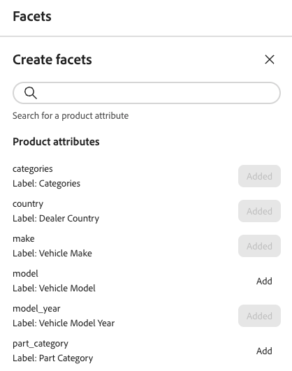

Tout attribut de produit filtrable peut être utilisé comme facette. Les facettes aident les clients à filtrer et à trouver plus facilement des produits dans votre magasin. Cet article explique comment ajouter, gérer et configurer des facettes dans votre storefront.

## Créer une facette

1. Dans le menu, sélectionnez _Marchandisage_ > **Facettes**, puis cliquez sur **Créer des facettes**.
1. Dans la liste *Créer des facettes*, chaque attribut disponible comporte un  distinct. Effectuez l’une des opérations suivantes :

   - Dans la liste *Attributs de facettes*, sélectionnez l’attribut de produit à utiliser comme facette et cliquez sur **Ajouter**.
   - Pour trouver un attribut de produit spécifique, saisissez les premiers caractères du nom de l&#39;attribut dans la zone *Rechercher*. Cliquez ensuite sur **Ajouter**.

   La facette est ajoutée en bas de la liste *Facettes dynamiques* et le bouton *Publier les modifications* devient disponible.

1. Si la facette à ajouter est introuvable, utilisez l’[API de métadonnées](https://developer.adobe.com/commerce/services/reference/rest/#tag/Metadata){target="_blank"} pour définir le paramètre `filterable` :

   `"filterable": true`

   La facette sera disponible dans le storefront la prochaine fois que le catalogue sera synchronisé avec la couche de données des services de marchandisage. Si la facette n’est pas disponible après deux heures, consultez [synchronisation des données](../../setup/data-sync.md).

## Modification des propriétés de facette (facultatif)

1. Recherchez la facette à modifier.
1. Cliquez sur le sélecteur () Plus .
1. Dans le menu, cliquez sur **Modifier**. Modifiez ensuite les propriétés suivantes selon vos besoins :

   - Libellé : permet de saisir le libellé de facette à utiliser.
   - Type de tri : sélectionnez l&#39;une des options suivantes :
     - Alphabétique : trie les facettes par ordre alphabétique
     - Count : trie les facettes en fonction du nombre de correspondances trouvées
   - Valeur max : saisissez le nombre maximal de valeurs de facette affichées dans le storefront. Entrées valides : 0 - 100 ; valeur par défaut : 8.

1. Une fois l’opération terminée, cliquez sur **Enregistrer**.

## Épingler/désépingler les facettes

L’épingle change de couleur lorsque vous cliquez dessus et est utilisée pour déplacer la facette vers la section *Facettes épinglées* ou *Facettes dynamiques*.

1. Pour épingler une facette en haut de la liste *Filtres*, recherchez-la dans la liste *Facettes dynamiques* et cliquez sur l’épingle grise ().

   L’épingle devient bleue et la facette se déplace vers la section *Facettes épinglées*.

1. Pour désépingler une facette, recherchez-la dans la liste *Facettes épinglées* et cliquez sur l’épingle bleue ().

   L’épingle devient grise et la facette passe à la section *Facettes dynamiques*.

>[!NOTE]
>
>L’ordre des facettes épinglées peut être incohérent s’il existe deux libellés portant le même nom.

## Suppression des facettes

1. Recherchez la facette dans la liste et cliquez sur le sélecteur () Plus .
1. Cliquez sur **Supprimer**.
1. Lorsque vous êtes invité à confirmer, cliquez sur **Supprimer la facette**.
La facette est supprimée du storefront une fois les modifications publiées.

## Publier les modifications

1. Pour mettre à jour le storefront avec vos modifications, cliquez sur **[!UICONTROL Publish]**.
1. Patientez environ 15 minutes pour que les mises à jour apparaissent dans votre boutique.

## Informations supplémentaires

- Pour configurer les intervalles et les regroupements de facettisation des prix, consultez [Paramètres](../../settings.md).
- En savoir plus sur les [types](type.md) de facettes.
