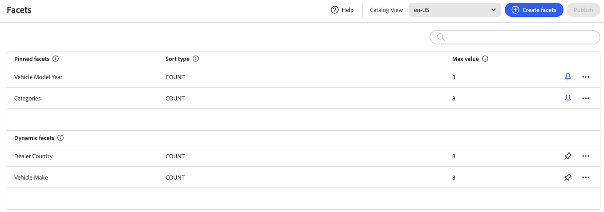

<!--
SOURCE OF TRUTH: Edit this file in the commerce.en repo:
https://github.com/Adobe-Enterprise-Docs/commerce.fr-FR/blob/main/help/_includes/ccdm-shared/merchandising/facets/workspace.md

This content is shared by the Adobe Commerce Optimizer Guide (commerce.en) and the
Merchandising Services with CCDM Guide (commerce-admin.en). Changes made in commerce.en
are synced automatically to commerce-admin.en, so do not edit the copy in that repo.
This includes related images in help/assets/ccdm-shared/.
-->

# Workspace à facettes

L’espace de travail *Facettes* répertorie toutes les facettes actuellement disponibles et permet d’accéder aux outils dont vous avez besoin pour configurer et gérer les facettes. Les facettes épinglées apparaissent en premier dans la liste des facettes existantes, suivies des facettes dynamiques. Vous pouvez effectuer une recherche dans la liste des facettes.

## Descriptions des champs

| Champ | Description |
|--- |--- |
| Création de facettes | Ouvre l&#39;[éditeur de facettes](add.md). |
| Libellé | Le [libellé de facette](type.md#facet-labels) visible dans le storefront peut être modifié par souci de cohérence avec votre marque. |
| Type de tri | Méthode utilisée pour [trier](type.md#sort-type) les facettes. Tous les storefronts trient les facettes par ordre alphabétique et par `Count`. Options : Alphabétique - Trie les facettes par ordre alphabétique. Count - Trie les facettes en fonction du nombre de correspondances trouvées. |
| Valeur max | Nombre maximal de valeurs pouvant être affichées dans le storefront pour chaque facette. Les facettes qui représentent une plage de valeurs sont également réparties. Entrées valides : 0 - 100 ; valeur par défaut : 8. |

## Contrôles

| Contrôle | Description |
|--- |--- |
|  | Épingle ou détache une facette en haut de la liste *Filtres*. |
|  | Affiche un menu d&#39;actions supplémentaires pouvant être appliquées à la facette sélectionnée. Options : Modifier, Supprimer |
