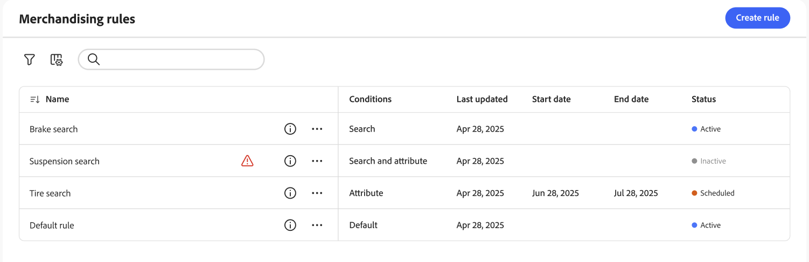

L’espace de travail *Règles de marchandisage* répertorie la sélection actuelle de règles et leur statut, et donne accès aux outils dont vous avez besoin pour créer et gérer des règles. Vous pouvez étendre les règles à toutes les [vues de catalogue](https://experienceleague.adobe.com/fr/docs/commerce/optimizer/setup/catalog-view) (globales) ou à une seule vue de catalogue. Voir [Sélectionner la vue de catalogue](#select-catalog-view) pour savoir comment filtrer par vue de catalogue et créer des règles par vue de catalogue. Dans l’espace de travail , vous pouvez :

- Rechercher des règles
- Afficher les détails de la règle
- Activer/désactiver les règles
- Supprimer les règles
- Accès à l’éditeur de règles

## Afficher/masquer les colonnes

1. Dans le coin supérieur droit, cliquez sur **Afficher/masquer** .

1. Dans le menu, effectuez l’une des opérations suivantes :

   - Pour afficher une colonne masquée, cliquez sur un nom de colonne sans coche.
   - Pour masquer une colonne visible, cliquez sur un nom de colonne avec une coche.

## Filtrer les règles par statut

1. Si votre boutique comporte de nombreuses règles, vous pouvez les filtrer par statut pour raccourcir la liste. Par défaut, la liste Règles affiche toutes les règles.

1. Pour répertorier uniquement les règles avec un paramètre de statut spécifique, définissez **Statut** sur l’une des valeurs suivantes :

   - Tous
   - Actif
   - Inactif
   - Planifié
   - Brouillon

   Vous pouvez également filtrer par **Conditions**, **Date de début**, **Date de fin** et **Dernière mise à jour**.

## Afficher les détails

Le panneau des détails affiche le nom de la règle, le statut, les conditions et les événements, les dates de début et de fin, la description et la date de la dernière modification. Les règles peuvent être activées, modifiées et supprimées à partir du panneau des détails.

1. Dans l’espace de travail *Règles de marchandisage*, recherchez la règle de la grille à afficher et cliquez sur l’icône ().

   Vous pouvez effectuer l’une des opérations suivantes à partir du menu :

   - Modifier la règle
   - Supprimer la règle
   - Activer/Désactiver La Règle

## Descriptions des colonnes

| Colonne | Description |
|--- |--- |
| Nom | Nom de la règle. |
| Dernière mise à jour | Date de la dernière mise à jour de la règle. |
| Date de début | Date de début d’une règle planifiée. |
| Date de fin | Date de fin d’une règle planifiée. |
| Statut | L’état avec code couleur indique l’état actuel de la règle. Utilisez la commande Statut au-dessus de la grille pour filtrer les règles par statut. Valeurs : Tous les statuts : affiche toutes les règles, quel que soit leur statut. Actif (bleu) - Affiche uniquement les règles actives. Planifié (orange) : affiche uniquement les règles planifiées. Inactif (gris) - affiche uniquement les règles inactives. |

## Contrôles

| Contrôle | Description |
|--- |--- |
| Ajouter une règle | Ouvre l&#39;éditeur de règles [&#128279;](add.md). |
| Vue Catalogue | Filtre le tableau en fonction des règles qui s’appliquent à la vue de catalogue sélectionnée. Définit également la portée lorsque vous [créez une règle](add.md). Options : *Toutes les vues* ou une [vue de catalogue](https://experienceleague.adobe.com/fr/docs/commerce/optimizer/setup/catalog-view) spécifique. Voir [Sélectionner la vue du catalogue](#select-catalog-view). |
| Statut | Filtre la liste des règles par statut. Options : Tous, Actif, Inactif, Planifié |
|  | Spécifie les colonnes visibles dans la grille. Options : Dernière mise à jour, Date de début, Date de fin, Statut |
| Rechercher | Recherche une règle par nom complet ou correspondance partielle. |
|  | Affiche un menu d’actions supplémentaires pouvant être appliquées à la règle sélectionnée. Options : Modifier, Afficher les détails, Supprimer |

## Détails de la règle

| Champ | Description |
|--- |--- |
| Statut | Statut actuel de la règle. |
| Conditions | Requête de recherche qui décrit les conditions associées à la règle. |
| Date de début | Date d’entrée en vigueur de la règle, le cas échéant. |
| Date de fin | Date d’expiration de la règle, le cas échéant. |
| Description | Brève description de la règle. |
| Dernière mise à jour : | Date et heure de la dernière mise à jour de la règle. |
| Activé | Contrôle qui modifie le statut de la règle. Options : Activé / Désactivé |

## Sélectionner la vue du catalogue

Le sélecteur **[!UICONTROL Catalog view]** de la page Règles de marchandisage effectue deux opérations :

1. **Filtre le tableau** : affiche uniquement les règles (et leurs détails) qui s’appliquent à la vue de catalogue sélectionnée.
1. **Définit la portée des nouvelles règles** - Lorsque vous [créez une règle](add.md), la vue de catalogue sélectionnée est utilisée comme portée de la règle. Les options sont *Toutes les vues* ou une [vue de catalogue](https://experienceleague.adobe.com/fr/docs/commerce/optimizer/setup/catalog-view) spécifique.

   - **Toutes les vues** - La règle s’applique à toutes les vues de catalogue. Le comportement de recherche et de classement est le même sur chaque storefront qui utilise le catalogue.
   - **Vue catalogue** - La règle s’applique uniquement à la vue catalogue sélectionnée (par exemple, un storefront, une région, un concessionnaire ou une marque). Utilisez cette option lorsque différentes vues de catalogue nécessitent une logique de marchandisage différente.

Pour plus d&#39;informations sur la création d&#39;une règle et la définition de son étendue, consultez [Créer et gérer des règles](add.md).

### Pourquoi créer une règle par vue de catalogue ?

Créez des règles par vue de catalogue lorsque différents storefronts, régions ou marques nécessitent un comportement de recherche et de classement différent. Exemples :

- **Réseaux de concessionnaires ou de distributeurs** - Chaque concessionnaire a sa propre vue de catalogue ; vous souhaitez différents produits épinglés, boostés ou enfouis par concessionnaire.
- **Multi-région** - Vues de catalogue distinctes pour l’UE, les États-Unis ou d’autres régions avec des règles de marchandisage spécifiques à la région.
- **Marque multiple** - Chaque marque possède sa propre vue de catalogue et vous souhaitez des règles spécifiques à la marque (par exemple, un classement par défaut différent ou des produits promus par marque).

Les données comportementales qui optimisent le [classement intelligent](add.md#intelligent-ranking) (telles que les plus consultées, les plus achetées, les tendances) sont calculées par vue de catalogue par défaut. Les règles qui utilisent le classement intelligent reflètent donc le comportement de l’acheteur de cette vue de catalogue. Lorsque votre compte comporte un grand nombre de vues de catalogue, le système peut agréger les données comportementales globalement afin de maintenir les performances. Dans ce cas, le classement peut être influencé davantage par les vues de catalogue à trafic élevé et la pertinence des vues à trafic faible peut être réduite. Voir [Limites et limites](https://experienceleague.adobe.com/fr/docs/commerce/optimizer/boundaries-limits) pour les limites actuelles.

### Configuration d’une règle par vue de catalogue

1. Dans l’espace de travail *Règles de marchandisage*, utilisez la liste déroulante **[!UICONTROL Catalog view]** pour sélectionner l’affichage du catalogue auquel la règle doit s’appliquer.
1. Cliquez sur **[!UICONTROL Create rule]**.

   La règle que vous créez est étendue à la vue de catalogue sélectionnée.
1. Créez votre règle dans l’éditeur de règles [&#128279;](add.md).

   Dans l’éditeur, définissez des conditions, des événements et des détails. La règle s’applique uniquement aux résultats de recherche dans cette vue de catalogue.

Vous ne pouvez pas modifier la vue de catalogue (portée) d’une règle après sa création. Pour appliquer une logique similaire à une autre vue de catalogue, créez une règle et sélectionnez cette vue de catalogue avant de la créer.
