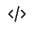

La page **Synchronisation des données** affiche un aperçu du statut de synchronisation des données de produit transférées depuis votre source de données (votre catalogue Commerce existant, le système de gestion des informations produit (PIM), le système de planification des ressources de l&#39;entreprise (ERP), etc.) dans la couche de données des services de marchandisage.

La page **Synchronisation des données** fournit des informations précieuses sur la disponibilité des données de produit pour votre storefront, en veillant à ce qu’elles puissent être rapidement affichées pour vos acheteurs.

## Accès à l’espace de travail de synchronisation des données

La façon dont vous ouvrez l&#39;espace de travail *Synchronisation des données* dépend du produit que vous utilisez :

- **Administrateur Adobe Commerce** (Adobe Commerce as a Cloud Service) : Sélectionnez *Magasins* > **Synchronisation Des Catalogues**.
- **Adobe Commerce Optimizer Studio** : sélectionnez *Configuration du magasin* > **Synchronisation des données**.

La page **Synchronisation des données** contient les champs suivants :

| Champ | Description |
| --- | --- |
| Source du catalogue | Paramètre régional spécifique pour les données synchronisées. |
| [!DNL Catalog Service] | Affiche la dernière mise à jour de synchronisation, le nombre total de produits reçus, un champ de recherche et un tableau des produits synchronisés pour [!DNL Catalog Service]. |
| Découverte de produits | Affiche la dernière mise à jour de synchronisation, le nombre total de produits reçus, un champ de recherche et un tableau des produits synchronisés pour la recherche. |
| Recommendations | Affiche la dernière mise à jour de synchronisation, le nombre total de produits reçus, un champ de recherche et un tableau des produits synchronisés pour Recommendations. |
| Produits reçus au cours des 3 dernières heures | Affiche le nombre de produits qui ont été transférés de la source du catalogue vers la couche de données des services de marchandisage au cours des trois dernières heures. Si vous effectuez des mises à jour peu fréquentes de votre catalogue, cette valeur est souvent égale à zéro. |
| Nombre total de produits dans le catalogue | Indique le nombre total de produits du catalogue disponibles dans la couche de données Services de marchandisage. |
| Produits synchronisés | Fournit des détails sur les produits synchronisés avec la couche de données des services de marchandisage. Par défaut, ce tableau est trié par « Dernière mise à jour ». Pour trouver un produit spécifique, utilisez le champ **[!UICONTROL Search by Name or SKU]**. |

## Liste des produits synchronisés

Pour afficher les détails d’un produit synchronisé au format JSON, cliquez sur l’icône de code  sur la ligne du produit dans le tableau des produits synchronisés.

## Resynchroniser les données du catalogue

Si vous ne voyez pas de produits spécifiques sur la page **Synchronisation des données**, vous devez lancer une resynchronisation à partir de votre système en amont. Gardez toutefois à l’esprit qu’une resynchronisation peut augmenter la charge sur les ressources matérielles. Néanmoins, une resynchronisation de votre catalogue peut être nécessaire dans les scénarios suivants :

- Lorsque des modifications importantes sont apportées à votre catalogue de produits, telles que l’ajout de nouveaux produits, la mise à jour des détails de produits ou la modification de catégories

- Si vous constatez des incohérences ou des problèmes de performances dans l’affichage des données de produits sur vos storefronts

>[!IMPORTANT]
>
>Le temps nécessaire à la synchronisation varie en fonction de la taille de votre catalogue et du volume de données mises à jour.

## Vérifier que la synchronisation des données fonctionne

Pour les projets qui utilisent Adobe Commerce comme source de données en amont, vous pouvez surveiller le processus d’exportation des données et lancer des opérations de resynchronisation à partir de la page Statut de synchronisation des flux de données . Pour plus d’informations, consultez [Surveillance du statut de synchronisation des flux de données](https://experienceleague.adobe.com/en/docs/commerce-admin/systems/data-transfer/data-sync/data-feed-sync-status).
