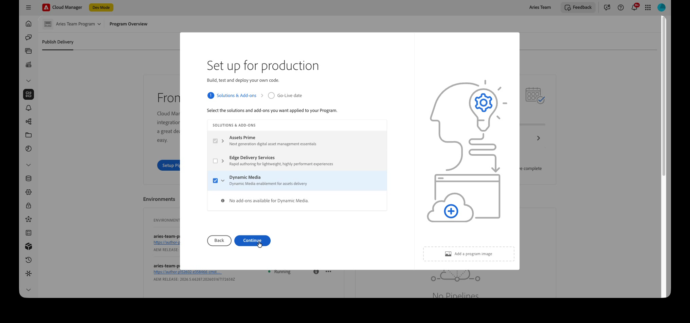
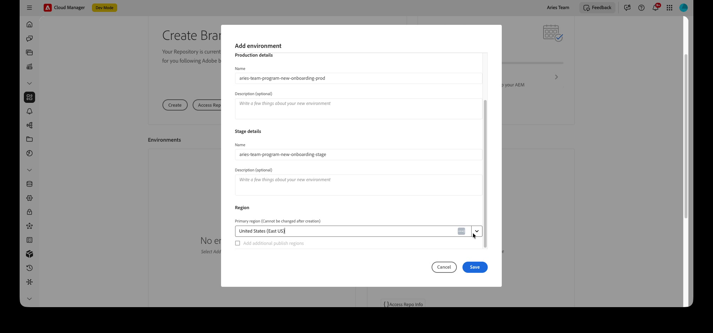
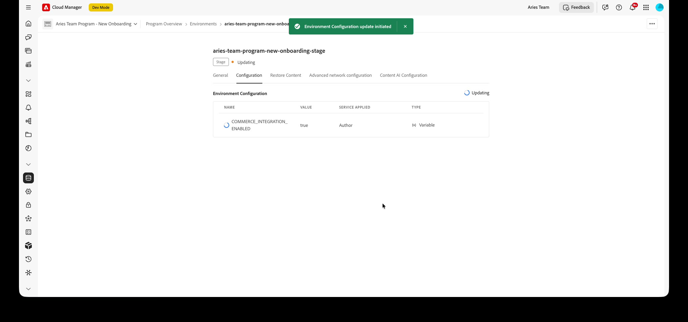
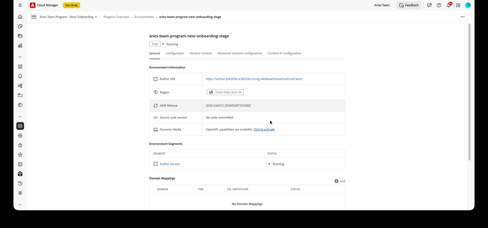
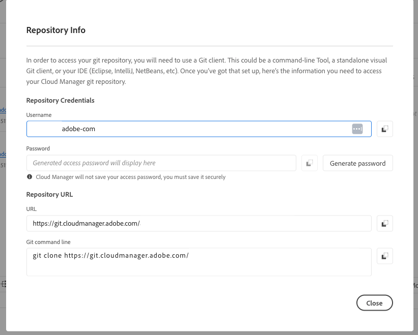
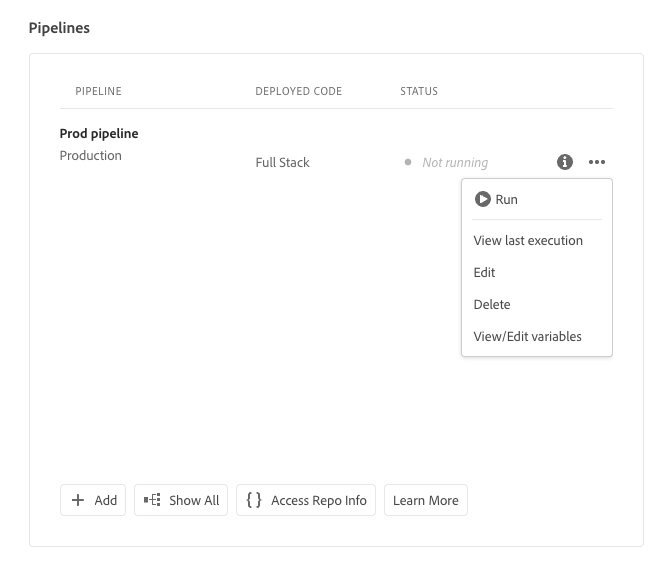
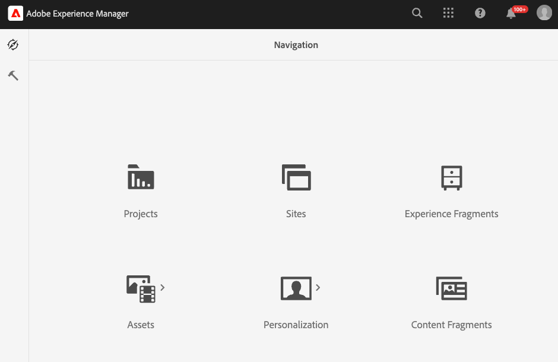
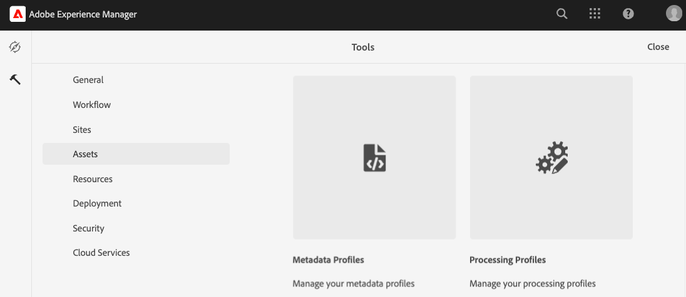
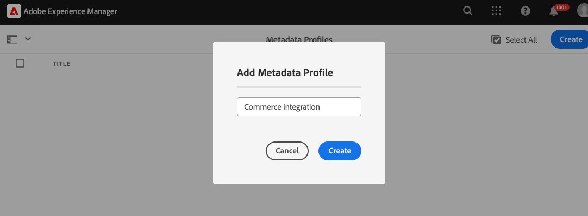
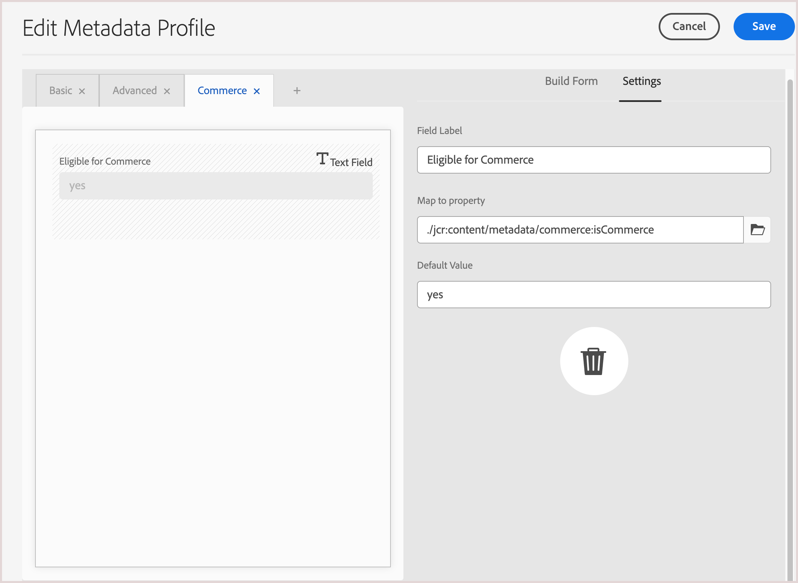

# Configuration du projet AEM Assets

Cette rubrique décrit comment configurer votre projet AEM Assets afin que l’espace de noms Commerce, le schéma de métadonnées et l’onglet [!UICONTROL Commerce] soient disponibles dans l’environnement de création AEM. Pour plus d’informations sur ces ressources, voir [Métadonnées Commerce dans AEM Assets](../metadata.md).

Vous disposez de deux options pour configurer le projet AEM Assets :

* [!BADGE Recommandé]{type=Positive} **Intégration en libre-service** — Sur les versions d’AEM `2026.5.26309` et ultérieures, activez l’intégration dans Cloud Manager en définissant une variable d’environnement et en activant Dynamic Media avec les fonctionnalités OpenAPI. Aucun déploiement de code personnalisé n’est requis. Voir [Activer l&#39;intégration de Commerce (libre-service)](#enable-aem-commerce-self-service).

* **Configuration manuelle** — Déployez le package `assets-commerce` via un pipeline Cloud Manager. Utilisez ces étapes manuelles lorsque vous devez déployer le code de package personnalisé ou si vous utilisez une version d’AEM antérieure à `2026.5.26309`. Voir [Installer manuellement le package assets-commerce](#install-the-assets-commerce-package-manually).

>[!TIP]
>
>Vous pouvez vérifier la version actuelle d’AEM dans le menu supérieur droit : **[!UICONTROL Help]** > **[!UICONTROL About AEM]**.

>[!IMPORTANT]
>
>Quelle que soit l’option utilisée, [configurez le schéma de métadonnées pour l’approbation des ressources](https://experienceleague.adobe.com/en/docs/experience-manager-cloud-service/content/assets/dynamicmedia/dynamic-media-open-apis/approve-assets#configuration) dans l’éditeur de schéma de métadonnées d’AEM afin de pouvoir approuver les ressources Commerce.

## Activer l’intégration de Commerce (libre-service) {#enable-aem-commerce-self-service}

[!BADGE Prise en charge]{type=Informative tooltip="Pris en charge"} d’AEM version `2026.5.26309` et ultérieure.

Dans les versions d’AEM prises en charge, vous activez l’intégration de Commerce à partir de Cloud Manager sans déployer de code personnalisé. L’espace de noms Commerce, le schéma de métadonnées et l’onglet **[!UICONTROL Commerce]** sont automatiquement configurés lorsque vous activez l’intégration sur le service de création.

### Conditions préalables relatives au libre-service

* [Accès au programme AEM Cloud Manager et aux environnements](https://experienceleague.adobe.com/en/docs/experience-manager-cloud-service/content/onboarding/journey/cloud-manager#access-sysadmin-bo) avec les rôles Responsable de programme et de déploiement.

* Un programme AEM à la version `2026.5.26309` ou ultérieure.

* L’**ID d’organisation IMS** pour votre instance Commerce.

  Votre instance Commerce et votre environnement de création AEM Assets doivent se trouver dans la même organisation IMS.

>[!NOTE]
>
>Les environnements d’évaluation et de développement d’AEM Assets nécessitent AEM Assets Ultimate. Consultez les [limites des visuels de produit](../../optimizer/boundaries-limits.md#product-visuals-limits) avant de planifier ces environnements. Cette exigence s’applique aux environnements AEM Assets, et non aux environnements sandbox Commerce.

### Étape 1 : créer le programme et les environnements

La création d’un programme dans Cloud Manager est un processus à plusieurs étapes : le programme et ses environnements sont configurés en plusieurs étapes et enregistrés ensemble.

1. Dans Cloud Manager, sélectionnez **[!UICONTROL Add Program]**.

1. Choisissez **[!UICONTROL Set up for production]**, saisissez un nom de programme, puis sélectionnez **[!UICONTROL Continue]**.

1. À l’étape **[!UICONTROL Solutions & Add-ons]**, sélectionnez les solutions et modules complémentaires dont votre projet a besoin, y compris **[!UICONTROL Dynamic Media]**, puis sélectionnez **[!UICONTROL Continue]**.

   {width="600" zoomable="yes"}

1. À l’étape **[!UICONTROL Add Environment]**, saisissez le nom de l’environnement **Production**, puis sélectionnez une région. Si votre droit comprend un environnement d’évaluation, saisissez également le nom de l’environnement d’évaluation **1&rbrace;.**

   >[!IMPORTANT]
   >
   >[!BADGE SaaS uniquement]{type=Positive url="https://experienceleague.adobe.com/en/docs/commerce/user-guides/product-solutions" tooltip="S’applique uniquement aux projets Adobe Commerce as a Cloud Service et Adobe Commerce Optimizer (infrastructure SaaS gérée par Adobe)."} Lors de la création des environnements AEM Assets pour cette intégration, sélectionnez une région de déploiement d’AEM prise en charge géographiquement proche de votre cellule Adobe Commerce as a Cloud Service.

   {width="600" zoomable="yes"}

1. Sélectionnez **[!UICONTROL Save]** pour créer le programme avec ses environnements.

### Étape 2 : activer la variable d&#39;intégration Commerce

Dans Cloud Manager, ouvrez l’environnement créé à l’étape 1, puis :

1. Sélectionnez l’onglet **[!UICONTROL Configuration]**.

1. Ajoutez une variable d’environnement avec les valeurs suivantes, puis sélectionnez **[!UICONTROL Add]** et **[!UICONTROL Save]** :

   | Champ | Valeur |
   |---|---|
   | Nom | `COMMERCE_INTEGRATION_ENABLED` |
   | Valeur | `true` |
   | Service appliqué | Auteur |
   | Type | Variable |

   Configuration de l’environnement {width="600" zoomable="yes"}

   L’environnement se met à jour pour appliquer la configuration. Patientez jusqu’à ce que le statut de l’environnement revienne à **[!UICONTROL Running]**.

### Étape 3 : activation de Dynamic Media avec les fonctionnalités OpenAPI

1. Dans l’onglet Environnement **[!UICONTROL General]**, localisez **[!UICONTROL Dynamic Media]**.

1. Pour *Les fonctionnalités OpenAPI sont disponibles*, sélectionnez **[!UICONTROL Click to activate]**.

   {width="600" zoomable="yes"}

   L’activation s’exécute en arrière-plan. Une fois l’opération terminée, l’environnement est prêt pour l’intégration de Commerce.

   >[!NOTE]
   >
   > Si **[!UICONTROL Click to activate]** n’est pas disponible, ouvrez un ticket de support pour activer Dynamic Media avec les fonctionnalités OpenAPI.

### Étape 4 : valider la configuration

Basculez vers l’**environnement de création AEM Assets** et ouvrez n’importe quelle ressource. Modifiez ses propriétés et vérifiez que le schéma de métadonnées par défaut inclut l’onglet **[!UICONTROL Commerce]** et que les champs **[!UICONTROL Product Data]** et **[!UICONTROL Eligible for Commerce]** sont visibles.

## Installation manuelle du package Assets-Commerce

>[!NOTE]
>
> Utilisez cette méthode manuelle pour déployer le code de package personnalisé ou si vous utilisez des versions d’AEM antérieures à `2026.5.26309`. Dans les versions prises en charge, utilisez [Activer l’intégration de Commerce (libre-service)](#enable-aem-commerce-self-service) à la place.

### Conditions préalables

Pour déployer le code du package `assets-commerce` dans l’environnement AEM Assets as a Cloud Service AEM, vous avez besoin des ressources et autorisations suivantes :

* [Accès au programme AEM Assets Cloud Manager et aux environnements](https://experienceleague.adobe.com/en/docs/experience-manager-cloud-service/content/onboarding/journey/cloud-manager#access-sysadmin-bo) avec les rôles Responsable de programme et de déploiement.

* Un [environnement de développement AEM local](https://experienceleague.adobe.com/en/docs/experience-manager-learn/cloud-service/local-development-environment-set-up/overview) et une bonne connaissance du processus de développement local AEM.

* Découvrez la [structure de projet AEM](https://experienceleague.adobe.com/fr/docs/experience-manager-cloud-service/content/implementing/developing/aem-project-content-package-structure) et comment déployer des packages de contenu personnalisés à l’aide de Cloud Manager.

* L’**ID d’organisation IMS** pour votre instance Commerce. Votre instance Commerce et votre environnement de création AEM Assets doivent se trouver dans la même organisation IMS.

* Pour activer [Dynamic Media avec les fonctionnalités OpenAPI](https://experienceleague.adobe.com/en/docs/experience-manager-cloud-service/content/assets/dynamicmedia/dynamic-media-open-apis/dynamic-media-open-apis-overview#enable-dynamic-media-open-apis) :

>[!BEGINTABS]

>[!TAB Visuels du produit]

[!BADGE SaaS uniquement]{type=Positive url="https://experienceleague.adobe.com/en/docs/commerce/user-guides/product-solutions" tooltip="S’applique uniquement aux projets Adobe Commerce as a Cloud Service et Adobe Commerce Optimizer (infrastructure SaaS gérée par Adobe)."} Dynamic Media avec fonctionnalités OpenAPI est en libre-service pour les visuels de produit optimisés par AEM Assets.

1. Accédez à votre Cloud Manager.

1. Sélectionnez l’environnement souhaité.

1. Activez **Dynamic Media avec les fonctionnalités OpenAPI**.

   Si le bouton **Dynamic Media avec fonctionnalités OpenAPI** n’est pas actif, ouvrez un ticket de support.

>[!TAB AEM Assets]

[!BADGE PaaS uniquement]{type=Informative tooltip="S’applique uniquement à Adobe Commerce sur les projets cloud (infrastructure PaaS gérée par Adobe)."} Sur AEM as a Cloud Service, envoyez un ticket d’assistance Adobe avec les informations suivantes :

* Titre : activer l’OpenAPI Dynamic Media pour intégrer entièrement Adobe Commerce à AEM Assets

  * Contenu du ticket d’assistance :

    * **[!UICONTROL AEM Program ID]**
    * **[!UICONTROL Adobe Commerce URL]**
    * **[!UICONTROL AEM Environment ID]**
    * **[!UICONTROL IMS Org ID]**

Une fois que vous avez envoyé le ticket d’assistance, Adobe active Dynamic Media avec les fonctionnalités OpenAPI dans votre environnement Cloud Services et partage les informations nécessaires, telles que l’identifiant du client IMS, pour que vous puissiez poursuivre l’intégration.

>[!ENDTABS]

### Etapes d&#39;installation

1. Accédez à AEM Cloud Manager, sélectionnez un programme, puis [créez des environnements de production et d’évaluation](https://experienceleague.adobe.com/en/docs/experience-manager-cloud-service/content/onboarding/journey/create-environments#creating-environments) que vous souhaitez intégrer à Adobe Commerce.

1. [Clonez le référentiel Git géré par Adobe](https://experienceleague.adobe.com/en/docs/experience-manager-cloud-service/content/sites/administering/site-creation/quick-site/retrieve-access#repo-access) pour le programme sélectionné.

   {width="600" zoomable="yes"}

   Dans les **pipelines** de Cloud Manager, sélectionnez **[!UICONTROL Access Repo Info]** pour ouvrir **[!UICONTROL Repository Info]**. Copiez la valeur **[!UICONTROL URL]** ou **[!UICONTROL Git command line]**, générez un mot de passe d’accès si nécessaire, puis clonez localement avec votre client Git.

1. À partir de GitHub, téléchargez le code du package à partir du [référentiel AEM Assets Commerce](https://github.com/ankumalh/assets-commerce).

1. À partir de votre [environnement de développement AEM local](https://experienceleague.adobe.com/en/docs/experience-manager-learn/cloud-service/local-development-environment-set-up/overview), copiez manuellement le code téléchargé dans le référentiel géré Adobe existant.

1. Dans l’ensemble des fichiers `filter.xml` et `pom.xml` de votre projet, remplacez toutes les occurrences de &lt;my-app> par le nom de votre application.

   >[!NOTE]
   >
   > Vous pouvez également installer le code personnalisé dans la configuration de votre projet AEM Assets sous forme de package **Maven**.

1. Validez les modifications et envoyez votre branche de développement local au référentiel Git de Cloud Manager.

1. Configurez un [pipeline de déploiement](https://experienceleague.adobe.com/en/docs/experience-manager-cloud-service/content/sites/administering/site-creation/quick-site/pipeline-setup#create-front-end-pipeline) ou vérifiez que votre pipeline peut déployer les modifications dans l’environnement sélectionné.

   {width="600" zoomable="yes"}

   Lorsque le pipeline existe, ouvrez le menu Actions (**...**) vers **[!UICONTROL Run]**, **[!UICONTROL Edit]**, **[!UICONTROL View/Edit variables]** ou d’autres actions : consultez la documentation sur le pipeline Cloud Manager liée ci-dessus.

1. À partir d’AEM Cloud Manager, [mettez à jour l’environnement AEM en utilisant le pipeline pour déployer votre code](https://experienceleague.adobe.com/en/docs/experience-manager-cloud-service/content/implementing/using-cloud-manager/deploy-code#deploying-code-with-cloud-manager).

1. Accédez à n’importe quelle ressource et modifiez ses propriétés pour valider les modifications :

   * Le schéma de métadonnées par défaut inclut l’onglet **Commerce**.

   * Les SKU de produit et les champs `Eligible for Commerce` sont visibles.

   * Le multichamp **[!UICONTROL Alt texts]** est disponible avec **[!UICONTROL Store View Code]** et **[!UICONTROL Alt Text]** entrées.

### L’onglet Commerce n’est pas visible dans les propriétés

Si l’onglet **Commerce** n’apparaît pas dans les propriétés, vous devez effectuer manuellement les étapes suivantes dans l’éditeur de schéma de métadonnées :

1. Accédez à l’éditeur de schéma de métadonnées.

1. Sélectionnez **Modifier** pour modifier le formulaire de schéma de métadonnées par défaut.

1. Créez un onglet **Commerce** et sélectionnez-le.

1. Faites glisser et déposez le composant **Product** dans l’onglet **Commerce** et mappez-le à la propriété `commerce:skus`.

1. Cochez la case **afficher les rôles** et **afficher la commande**.

1. Faites glisser et déposez un composant **case à cocher** dans l’onglet **Commerce** et mappez-le à la propriété `commerce:isCommerce`. Définissez **Oui** et **Non** comme options.

1. Ajoutez le multichamp **[!UICONTROL Alt texts]** à l’onglet **Commerce**. Configurez ses deux propriétés alignées sur l’index en tant que `commerce:altTextStoreViews` et `commerce:altTextValues`.

Si vous rencontrez d’autres problèmes, créez un [ticket d’assistance](https://experienceleague.adobe.com/en/docs/support-resources/adobe-support-tools-guide/adobe-commerce-support/adobe-commerce-help-center-user-guide#support-case) ou contactez votre représentant commercial pour l’intégration AEM Assets pour obtenir de l’aide.

## Configuration d’un profil de métadonnées (facultatif)

Dans l’environnement de création AEM Assets, définissez les valeurs par défaut des métadonnées de ressources Commerce en créant un profil de métadonnées. Pour utiliser automatiquement ces valeurs par défaut, appliquez le nouveau profil aux dossiers AEM Asset. Cette configuration simplifie le traitement des ressources en réduisant les étapes manuelles.

Lorsque vous configurez le profil de métadonnées, il vous suffit de configurer les composants suivants :

* Ajoutez un onglet Commerce . Cet onglet active les paramètres de configuration spécifiques à Commerce ajoutés par le modèle.

* Ajoutez le champ `Eligible for Commerce` à l’onglet Commerce .

Le composant d’interface utilisateur des données de produit est ajouté automatiquement en fonction du modèle.

### Définition du profil de métadonnées

1. Connectez-vous à l’environnement de création de Adobe Experience Manager.

1. Dans l’espace de travail Adobe Experience Manager , accédez à l’espace de travail Créer une administration de contenu pour AEM Assets en cliquant sur l’icône Adobe Experience Manager .

   {width="600" zoomable="yes"}

1. Ouvrez les outils d’administration en sélectionnant l’icône en forme de marteau.

   {width="600" zoomable="yes"}

1. Ouvrez la page de configuration du profil en cliquant sur **[!UICONTROL Metadata Profiles]**.

1. **[!UICONTROL Create]** un profil de métadonnées pour l’intégration de Commerce.

   {width="600" zoomable="yes"}

1. Ajoutez un onglet pour les métadonnées Commerce.

   1. Sur la gauche, cliquez sur **[!UICONTROL Settings]**.

   1. Cliquez sur **[!UICONTROL +]** dans la section d’onglet, puis spécifiez le **[!UICONTROL Tab Name]**, `Commerce`.

1. Ajoutez le champ `Eligible for Commerce` au formulaire.

   {width="600" zoomable="yes"}

   * Cliquez sur **[!UICONTROL Build form]**.

   * Faites glisser le champ `Single Line text` vers le formulaire.

   * Ajoutez le texte `Eligible for Commerce` pour le libellé en cliquant sur **[!UICONTROL Field Label]**.

   * Dans l’onglet Paramètres , ajoutez le texte du libellé au **Libellé du champ**.

   * Définissez le texte d’espace réservé sur `yes`.

   * Dans le champ **[!UICONTROL Map to Property]**, copiez et collez la valeur suivante :

     ```terminal
     ./jcr:content/metadata/commerce:isCommerce
     ```

1. Facultatif. Pour synchroniser automatiquement les Assets Commerce approuvées lors de leur chargement dans l’environnement AEM Assets, définissez la valeur par défaut du champ _[!UICONTROL Review Status]_&#x200B;sur `approved` dans l’onglet `Basic`.

1. Enregistrez la mise à jour.

### Application du profil de métadonnées au dossier source Commerce Assets

1. Sur la page **[!UICONTROL Metadata Profiles]**, sélectionnez le profil d’intégration de Commerce.

1. Dans le menu Action, sélectionnez **[!UICONTROL Apply Metadata Profiles to Folders]**.

1. Sélectionnez le dossier contenant Commerce Assets.

   Créez un dossier Commerce s’il n’existe pas.

1. Sélectionnez **[!UICONTROL Apply]**.

## Étapes suivantes

* [!BADGE PaaS uniquement]{type=Informative tooltip="S’applique uniquement à Adobe Commerce sur les projets cloud (infrastructure PaaS gérée par Adobe)."} [Installez les packages Adobe Commerce](configure-commerce.md).

* [!BADGE SaaS uniquement]{type=Positive url="https://experienceleague.adobe.com/en/docs/commerce/user-guides/product-solutions" tooltip="S’applique uniquement aux projets Adobe Commerce as a Cloud Service et Adobe Commerce Optimizer (infrastructure SaaS gérée par Adobe)."} [Configurez l&#39;intégration à partir de l&#39;administrateur](setup-synchronization.md).
