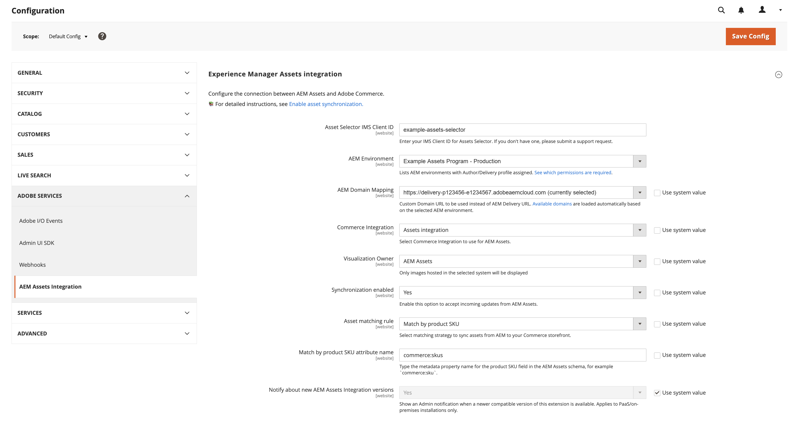

# Configuration de l’intégration

Configurez l’intégration en connectant Commerce à l’instance AEM Assets et en sélectionnant la stratégie correspondante pour la synchronisation des ressources.

Après avoir identifié le projet AEM Assets, sélectionnez la règle correspondante pour synchroniser les ressources entre Adobe Commerce et AEM Assets.

* **[!UICONTROL Match by product SKU]** - Règle par défaut qui correspond au SKU dans les métadonnées de ressource avec le [SKU de produit Commerce](https://experienceleague.adobe.com/en/docs/commerce-operations/implementation-playbook/glossary#sku) pour s’assurer que les ressources sont associées aux produits corrects.

* **[!UICONTROL Custom match]** : règle de correspondance pour les scénarios plus complexes ou les besoins spécifiques de l’entreprise qui nécessitent une logique de correspondance personnalisée. L’implémentation d’une correspondance personnalisée nécessite le développement d’un code personnalisé dans Adobe Developer App Builder pour définir la manière dont les ressources sont associées aux produits. Voir [Correspondance automatique personnalisée](../synchronize/custom-match.md).

Pour la configuration initiale, utilisez la règle **[!UICONTROL Match by product SKU]** par défaut.

## Conditions requises

Avant de configurer l’intégration AEM Assets, vérifiez que vous avez effectué les étapes suivantes :

* [Configuration du projet AEM Assets](configure-aem.md)

* [!BADGE PaaS uniquement]{type=Informative tooltip="S’applique uniquement à Adobe Commerce sur les projets cloud (infrastructure PaaS gérée par Adobe)."} [Installez les packages Adobe Commerce](configure-commerce.md) pour ajouter l’extension et générer les informations d’identification et les connexions requises pour utiliser l’extension.

* [Autorisations d’utilisateur et IMS](permissions.md) : configurez les autorisations requises pour le sélecteur de ressources, la sélection d’environnement AEM et le mappage de domaine.

## Configurer la connexion

{width="900" zoomable="yes"}

1. Depuis l’administration Commerce, accédez à **[!UICONTROL Stores]** > **[!UICONTROL Settings]** > **[!UICONTROL Configuration]** > **[!UICONTROL ADOBE SERVICES]** > **[!UICONTROL AEM Assets Integration]**.

>[!INFO]
>
> L’intégration d’AEM Assets ne prend en charge la configuration qu’à la portée globale (par défaut). La configuration au niveau du site web n’est pas prise en charge. Lorsque vous tentez de configurer l’intégration au niveau du site web, le système ignore les paramètres au niveau du site web et utilise plutôt les valeurs de configuration globales.

1. [!BADGE PaaS uniquement]{type=Informative tooltip="S’applique uniquement à Adobe Commerce sur les projets cloud (infrastructure PaaS gérée par Adobe)."} Entrez **[!UICONTROL Asset Selector IMS Client ID]**.

   Cet identifiant est requis pour activer le sélecteur de ressources. Voir [Autorisations d&#39;utilisateur et IMS](permissions.md) pour obtenir cet identifiant. Pour plus d’informations sur le sélecteur de ressources, voir [Sélection manuelle des ressources](../synchronize/asset-selector-integration.md).

1. Dans **[!UICONTROL AEM Environment]**, sélectionnez l’environnement configuré dans [Configurer le projet AEM Assets](configure-aem.md).

   La liste comprend les environnements AEM pour lesquels votre utilisateur dispose d’un profil de produit Auteur ou Diffusion . Si l’environnement attendu est manquant, vérifiez les [autorisations utilisateur et IMS](permissions.md).

   Si votre configuration affiche plutôt des champs **[!UICONTROL Program ID]** et **[!UICONTROL Environment ID]** distincts, spécifiez les identifiants de cet environnement. Pour une saisie manuelle, copiez-les à partir d’AEM Cloud Manager ou dérivez-les de votre URL de création : `https://author-p<ProgramID>-e<EnvironmentID>.adobeaemcloud.com/`. Saisissez uniquement les identifiants numériques, sans les préfixes `p` et `e`.

   Pour les champs avec une case à cocher **[!UICONTROL Use system value]**, désélectionnez-la avant de remplacer la valeur par défaut.

1. Vérifier **[!UICONTROL AEM Domain Mapping]**. Les domaines disponibles sont chargés automatiquement en fonction de l’environnement AEM sélectionné. Si votre projet utilise un domaine de diffusion de ressources personnalisé, suivez [Configurer l’URL du domaine personnalisé](#optional-configure-the-custom-domain-url).

1. [!BADGE PaaS uniquement]{type=Informative tooltip="S’applique uniquement à Adobe Commerce sur les projets cloud (infrastructure PaaS gérée par Adobe)."} Sélectionnez le [[!UICONTROL Commerce integration]](configure-commerce.md#add-the-integration-to-the-commerce-environment) pour authentifier les requêtes entre Commerce et le service de correspondance des ressources.

1. Définissez **[!UICONTROL Synchronization enabled]** sur `Yes` pour permettre à Commerce d’accepter les mises à jour entrantes en provenance d’AEM Assets.

   Après avoir activé l’intégration, des options de configuration supplémentaires sont disponibles pour spécifier les critères de correspondance des ressources.

1. Sélectionnez l’une des règles de correspondance de ressources pour la synchronisation des ressources dans la liste déroulante **[!UICONTROL Asset matching rule]**.

   * Sélectionnez **[!UICONTROL Match by product SKU]** pour [la correspondance automatique par défaut](../synchronize/default-match.md).
   * Sélectionnez **[!UICONTROL Custom match]** pour [la correspondance automatique personnalisée](../synchronize/custom-match.md). Cette option nécessite [Adobe Developer App Builder](https://experienceleague.adobe.com/en/docs/commerce-learn/tutorials/extensibility/adobe-developer-app-builder/introduction-to-app-builder).

1. Pour **[!UICONTROL Match by product SKU]**, saisissez le [nom de propriété des métadonnées AEM Assets](../metadata.md) dans le champ **[!UICONTROL Match by product SKU attribute name]**. La valeur par défaut est `commerce:skus`.

   Saisissez le nom de la propriété, et non une valeur de SKU du produit. Ajoutez les SKU de produit réels aux **[!UICONTROL Product Data]** métadonnées de chaque ressource dans AEM Assets, comme décrit dans [Correspondance automatique par défaut](../synchronize/default-match.md).

1. Vérifiez le paramètre [Propriétaire de la visualisation](#configure-the-visualization-owner). Pendant la migration, conservez la propriété **Adobe Commerce** jusqu’à la fin de la synchronisation des ressources.

1. Sélectionnez **[!UICONTROL Save Config]** pour appliquer des mises à jour et lancer la synchronisation des ressources.

   La mise à jour de la configuration déclenche le processus de synchronisation initial, ce qui permet à Commerce d’accepter les mises à jour entrantes provenant d’AEM Assets. Le temps nécessaire à la synchronisation dépend du volume de ressources et de configurations spécifiques. L’intégration tire parti de processus automatisés afin de réduire le temps nécessaire à la synchronisation.

### SLA de synchronisation

Le service level agreement (SLA) de l’intégration garantit les niveaux de performances de synchronisation suivants :

* `< 5 minutes for 99% of updates`

* `< 30 minutes for 99.9% of updates`

Ce niveau de service garantit que les pages produit affichent toujours les images les plus récentes, tout en préservant la précision et l’attrait visuel du contenu du storefront.

## Synchroniser le texte de remplacement localisé

Le texte de remplacement localisé utilise le processus de synchronisation des ressources existant. Vous n’avez pas besoin d’un nouveau type d’événement ni d’une configuration de synchronisation distincte.

1. Ajoutez une ou plusieurs lignes de texte secondaire de vue de magasin dans l’onglet **[!UICONTROL Commerce]** de la ressource AEM.

1. Associez la ressource au SKU du produit Commerce.

1. Approuvez la ressource dans AEM Assets.

1. Attendez la fin de l’événement de ressource et du processus de synchronisation.

1. Vérifiez la valeur localisée dans Commerce Admin et dans la réponse du storefront.

Pour les noms de champ, les règles de validation et le résultat de Commerce, consultez [Métadonnées Commerce dans AEM Assets](../metadata.md).

## Configuration du propriétaire de la visualisation

Le paramètre **Propriétaire de la visualisation** détermine le système qui diffuse les images de produit dans l’intégration :

* Adobe Commerce - Utilise des images hébergées dans Commerce.

* AEM Assets - Utilise des images synchronisées à partir d’AEM.

L’administrateur affiche les images disponibles pour ce propriétaire, tandis que le reste des images est grisé et affiché avec un libellé **masqué**.

Voir la rubrique [définition des détails de l’image](https://experienceleague.adobe.com/en/docs/commerce-admin/catalog/products/digital-assets/product-image#set-image-details){target=_blank} pour plus d’informations sur le comportement d’affichage des images.

>[!TIP]
>
> Lors d’une migration de Commerce vers AEM Assets, définissez le **Propriétaire de la visualisation** sur Commerce afin d’éviter la rupture des liens d’image. Une fois tous les produits synchronisés avec AEM Assets, basculez vers le propriétaire d’AEM Assets pour terminer la transition. Cela garantit la disponibilité continue des images tout au long du processus.

1. Accédez à **[!UICONTROL Stores]** > **[!UICONTROL Settings]** > **[!UICONTROL Configuration]** > **[!UICONTROL ADOBE SERVICES]** > **[!UICONTROL AEM Assets Integration]**.

   {width="700" zoomable="yes"}

1. Sélectionnez la source **Propriétaire de la visualisation** pour afficher les images.

1. Cliquez sur **[!UICONTROL Save Config]** pour appliquer les mises à jour.

   Avant de passer à **AEM Assets**, [vérifiez que les ressources sont associées aux produits attendus](#verify-the-integration). Ensuite, [configurez votre storefront](configure-storefront.md) pour afficher les images du produit AEM Assets.

## Facultatif. Configuration de l’URL du domaine personnalisé

Si le projet AEM Assets as a Cloud Service a été configuré avec un [nom de domaine personnalisé](https://experienceleague.adobe.com/fr/docs/experience-manager-cloud-service/content/implementing/using-cloud-manager/custom-domain-names/add-custom-domain-name){target=_blank}, vous devez ajouter le nom de domaine à la configuration du magasin Commerce afin que l’intégration AEM Assets pour Commerce puisse l’utiliser.

Obtenez l’URL de domaine personnalisé de diffusion de ressources configurée auprès de votre administrateur AEM. Ce paramètre remplace l’URL de diffusion AEM ; il ne s’agit pas de l’URL d’auteur AEM utilisée pour identifier l’ID de programme et l’ID d’environnement. Si votre projet n’utilise pas de domaine personnalisé, laissez le mappage de domaine inchangé.

>[!NOTE]
>
>La configuration d’une URL de domaine personnalisé ne met pas à jour les URL des ressources précédemment synchronisées. Ces ressources conservent leurs URL précédentes jusqu’à ce qu’elles soient [retraitées dans AEM Assets](https://experienceleague.adobe.com/en/docs/experience-manager-cloud-service/content/assets/manage/reprocessing){target=_blank}. Après avoir enregistré la configuration de domaine personnalisé, retraitez ces ressources pour mettre à jour leurs URL afin d’utiliser le domaine personnalisé.

1. Accédez à **[!UICONTROL Stores]** > **[!UICONTROL Settings]** > **[!UICONTROL Configuration]** > **[!UICONTROL ADOBE SERVICES]** > **[!UICONTROL AEM Assets Integration]**.

1. Confirmez le **[!UICONTROL AEM Environment]** sélectionné, puis sélectionnez le domaine personnalisé configuré à partir de **[!UICONTROL AEM Domain Mapping]**. Les domaines disponibles sont automatiquement chargés pour l’environnement sélectionné.

{width="700" zoomable="yes"}

    Pour les configurations qui affichent plutôt un champ de texte **[!UICONTROL Asset Custom Domain]**, saisissez l’URL de domaine personnalisé dans ce champ.

1. Cliquez sur **[!UICONTROL Save Config]** pour appliquer les mises à jour.

## Vérification de l’intégration

>[!NOTE]
>
>Le statut de synchronisation n’est pas disponible pour Adobe Commerce Optimizer. Suivez le [workflow de vérification de Commerce Optimizer](configure-aco.md#match-by-sku-workflow-example) au lieu des vérifications Commerce Admin ci-dessous.

1. Choisissez un produit Commerce existant et notez son SKU.

1. Dans AEM Assets, marquez une ressource de test comme **[!UICONTROL Eligible for Commerce]**, associez-la à ce SKU de produit et définissez son rôle et sa position. Approuvez la ressource. Consultez [Correspondance automatique par défaut](../synchronize/default-match.md) ou utilisez votre [règle de correspondance personnalisée](../synchronize/custom-match.md) configurée.

1. Une fois la synchronisation terminée, ouvrez le produit dans Commerce Admin et vérifiez sa section **[!UICONTROL Images And Videos]** pour connaître la ressource, le rôle et la position associés. Voir [Gestion des ressources](../manage-assets.md).

1. Vérifiez le [statut de synchronisation](sync-status.md) du résultat de la synchronisation de la ressource. Si la synchronisation échoue, passez en revue la colonne **[!UICONTROL Error]**.

1. Après avoir sélectionné **AEM Assets** en tant que propriétaire de la visualisation et terminé la [configuration du storefront](configure-storefront.md), ouvrez le produit sur le storefront et confirmez que l’image attendue s’affiche.

[!BADGE PaaS uniquement]{type=Informative tooltip="S’applique uniquement à Adobe Commerce sur les projets cloud (infrastructure PaaS gérée par Adobe)."} Pour effectuer un dépannage de synchronisation supplémentaire, consultez les [journaux d’intégration](logs.md).

## Étape suivante

* [Configurez votre storefront Commerce](configure-storefront.md) pour afficher les images des produits AEM Assets avec Edge Delivery Services.

* Configurez [les règles correspondantes](../synchronize/default-match.md) entre Adobe Commerce et l’intégration AEM Assets.

* [Gestion des ressources Commerce](../manage-assets.md).
