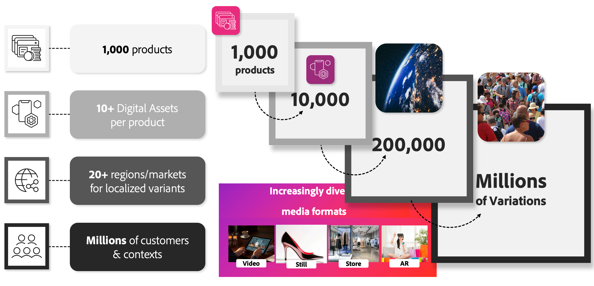

# Intégration d’AEM Assets pour Commerce

La demande de contenu personnalisé augmente rapidement tandis que les budgets marketing sont sous pression. Les détaillants et les marques ont du mal à suivre le rythme du besoin croissant de variations dans l’imagerie des produits, liées aux exigences régionales, saisonnières et spécifiques aux segments.

Prenons l’exemple d’un retailer contenant 1 000 produits. Le nombre de ressources numériques requises augmente considérablement en fonction des différentes régions, des segments de clientèle et des efforts de personnalisation. Cette situation peut entraîner un nombre écrasant de variations d’actifs, pouvant atteindre plusieurs millions.

{width="700" zoomable="yes"}

L’intégration d’AEM Assets relève ce défi en automatisant les workflows de gestion des ressources. L’intégration relie dynamiquement les ressources numériques aux produits et catégories Adobe Commerce appropriés en fonction du SKU ou d’autres attributs clés. Ce processus simplifie les opérations et améliore l’efficacité en permettant :

* **Installation et configuration transparentes**- Les équipes de marchandisage et les développeurs peuvent rapidement configurer l’intégration à l’aide des outils et des workflows Adobe habituels.

* **Mises à jour dynamiques des ressources** - Les images de produit et les ressources marketing reflètent automatiquement les dernières modifications d’AEM Assets, préservant la précision et la pertinence des storefronts.

* **Gestion rationalisée des catalogues** - Automatise l’actualisation et le nettoyage des ressources, ce qui réduit les efforts manuels et garantit la cohérence et la maintenance du catalogue de produits.

* **Texte secondaire d’image localisé** - Les marketeurs peuvent créer du texte secondaire pour chaque vue de magasin Commerce. L’intégration synchronise la valeur avec le champ image standard Commerce **[!UICONTROL Label]**.

* **Rôles d’image personnalisés** - Avec l’extension d’intégration AEM Assets version 1.4.6 ou ultérieure, les rôles d’image personnalisés configurés dans AEM Assets sont conservés pendant la synchronisation, en plus des quatre rôles standard. Voir [Correspondance automatique personnalisée](synchronize/custom-match.md).

* **Notifications de mise à jour d’extension** - Avec l’extension d’intégration AEM Assets version 1.4.6 ou ultérieure, Commerce recherche de nouvelles versions d’extension et en informe les administrateurs. Voir [Rechercher les mises à jour d&#39;extension](get-started/check-for-updates.md).

La localisation du texte de remplacement ne modifie pas l’affectation de l’image du produit ou le mappage de la galerie. La disponibilité des ressources en affichage de magasin est une fonctionnalité distincte et n’est pas couverte par le workflow de texte secondaire.

La fonctionnalité Product Visuals optimisée par AEM Assets prend en charge les cas d’utilisation de gestion des ressources axée sur Commerce dans Adobe Commerce as a Cloud Service et Adobe Commerce Optimizer. Pour connaître les fonctionnalités prises en charge, les limites de capacité et les fonctionnalités qui nécessitent AEM Assets Ultimate, consultez [Limites des visuels de produit](../optimizer/boundaries-limits.md#product-visuals-limits).

## Conditions requises pour utiliser l’intégration

Pour tirer parti de cette intégration avec [Product Visuals ou AEM Assets](https://experienceleague.adobe.com/fr/docs/commerce/cloud-service/overview#product-visuals-powered-by-aem-assets), les entreprises doivent répondre aux exigences suivantes :

>[!BEGINTABS]

>[!TAB Visuels du produit]

[!BADGE SaaS uniquement]{type=Positive url="https://experienceleague.adobe.com/fr/docs/commerce/user-guides/product-solutions" tooltip="S’applique uniquement aux projets Adobe Commerce as a Cloud Service et Adobe Commerce Optimizer (infrastructure SaaS gérée par Adobe)."} licences actives pour Adobe Commerce, Product Visuals optimisé par AEM Assets et [AEM Dynamic Media](https://experienceleague.adobe.com/fr/docs/experience-manager-65/content/assets/dynamic/administering-dynamic-media) (ces licences sont disponibles clé en main avec [!DNL Adobe Commerce as a Cloud Service] et [!DNL Adobe Commerce Optimizer]).

>[!TAB AEM Assets]

[!BADGE SaaS uniquement]{type=Positive url="https://experienceleague.adobe.com/fr/docs/commerce/user-guides/product-solutions" tooltip="S’applique uniquement aux projets Adobe Commerce as a Cloud Service et Adobe Commerce Optimizer (infrastructure SaaS gérée par Adobe)."} licences actives pour Adobe Commerce, Adobe Experience Manager Assets et [AEM Dynamic Media](https://experienceleague.adobe.com/fr/docs/experience-manager-65/content/assets/dynamic/administering-dynamic-media).

[!BADGE PaaS uniquement]{type=Informative tooltip="S’applique uniquement à Adobe Commerce sur les projets cloud (infrastructure PaaS gérée par Adobe)."} Adobe Commerce 2.4.5+

* Adobe Commerce 2.4.5+. Pour plus d’informations, voir [Configuration requise](https://experienceleague.adobe.com/fr/docs/commerce-operations/installation-guide/system-requirements){target="_blank"}.

[!BADGE SaaS uniquement]{type=Positive url="https://experienceleague.adobe.com/fr/docs/commerce/user-guides/product-solutions" tooltip="S’applique uniquement aux projets Adobe Commerce as a Cloud Service et Adobe Commerce Optimizer (infrastructure SaaS gérée par Adobe)."} Adobe Experience Manager est configuré avec [Adobe Experience Manager Assets as a Cloud Service](https://experienceleague.adobe.com/fr/docs/experience-manager-cloud-service/content/assets/overview)

>[!ENDTABS]

L’utilisateur d’Adobe Commerce qui configure l’intégration doit avoir accès à l’[organisation IMS](https://experienceleague.adobe.com/fr/docs/core-services/interface/administration/organizations#concept_EA8AEE5B02CF46ACBDAD6A8508646255) où le projet AEM Assets est configuré.

>[!BEGINSHADEBOX]

## Principaux avantages commerciaux

 **Pas de frais supplémentaires** - Cette intégration est fournie gratuitement pour les commerçants qui répondent aux exigences de licence.

 **Solution Adobe officielle** - Développée, conservée et entièrement prise en charge par Adobe, assurant la stabilité et l’alignement avec les améliorations futures de la plateforme.

 **Modèle de prise en charge gérée par Adobe** - Adobe gère directement l’assistance et le dépannage, en fournissant une prise en charge fiable et une résolution rationalisée des problèmes.

 **Fonctionnalités du Storefront Builder d’Adobe** - La solution de gestion des ressources numériques (DAM) permet d’utiliser des ressources telles que des images, des vidéos et d’autres médias sur le [Storefront Builder](https://experienceleague.adobe.com/en/tools/commerce-storefront/merchants/storefront-builder/#userlabs-commerce-genai-product-visuals).

>[!ENDSHADEBOX]

## Tutoriel

Pour découvrir comment configurer et utiliser l’intégration d’AEM Assets à Adobe Commerce, regardez ces vidéos.

>[!BEGINTABS]

>[!TAB Tutoriel Adobe Commerce sur le cloud ou sur site]

Pour découvrir comment Adobe Commerce et AEM Assets fonctionnent ensemble pour rationaliser les workflows de contenu, regardez cette vidéo :

>[!VIDEO](https://video.tv.adobe.com/v/3447885?captions=fre_fr)

>[!TAB Tutoriel Adobe Commerce as a Cloud Service]

Découvrez comment utiliser Adobe Commerce as a Cloud Service avec l’intégration d’AEM Assets.

>[!VIDEO](https://video.tv.adobe.com/v/3478140?quality=12&learn=on)

>[!ENDTABS]

## Étapes suivantes

Le processus d’installation et de configuration de l’intégration AEM Assets dépend de votre déploiement Adobe Commerce. Dans tous les cas, vous devez d’abord configurer AEM Assets, puis y connecter Commerce.

Pour comprendre l’espace de noms, le schéma de métadonnées et l’onglet **[!UICONTROL Commerce]** que l’intégration ajoute à votre environnement AEM Assets, consultez [Métadonnées Commerce dans AEM Assets](metadata.md) avant de commencer.

Pour le texte secondaire d’image localisé, voir [Texte secondaire localisé dans les métadonnées AEM Assets](metadata.md#localized-alt-text-in-aem-assets-metadata). Pour obtenir des instructions sur l’installation et la synchronisation, consultez les sections [Configurer le projet AEM Assets](get-started/configure-aem.md) et [Configurer l’intégration](get-started/setup-synchronization.md).

Sélectionnez votre déploiement pour suivre les étapes requises dans l’ordre :

>[!BEGINTABS]

>[!TAB Adobe Commerce as a Cloud Service]

[!BADGE SaaS uniquement]{type=Positive tooltip="S’applique uniquement aux projets Adobe Commerce as a Cloud Service (infrastructure SaaS gérée par Adobe)."}

1. Pour prendre en charge les métadonnées Commerce, [configurez le projet AEM Assets](get-started/configure-aem.md). Sur AEM version `2026.5.26309` et ultérieure, utilisez l’intégration en libre-service [2&rbrace; ; sur les versions antérieures, installez le package `assets-commerce` manuellement.](get-started/configure-aem.md#enable-aem-commerce-self-service)

1. [Configurez les autorisations d’utilisateur IMS](get-started/permissions.md) pour le sélecteur de ressources, ainsi que pour la sélection d’environnements et de domaines AEM.

1. [Configurez l’intégration dans l’administration Commerce](get-started/setup-synchronization.md).

1. Facultatif. [Activez l’affichage des images de produit](get-started/configure-storefront.md#enable-product-images) afin qu’un storefront optimisé par Edge Delivery Services effectue le rendu des images de produit gérées par AEM.

>[!TAB Adobe Commerce on Cloud (PaaS)]

[!BADGE PaaS uniquement]{type=Informative tooltip="S’applique uniquement à Adobe Commerce sur les projets cloud (infrastructure PaaS gérée par Adobe)."}

1. Pour prendre en charge les métadonnées Commerce, [configurez le projet AEM Assets](get-started/configure-aem.md). Sur AEM version `2026.5.26309` et ultérieure, utilisez l’intégration en libre-service [2&rbrace; ; sur les versions antérieures, installez le package `assets-commerce` manuellement.](get-started/configure-aem.md#enable-aem-commerce-self-service)

1. [Installez les packages Adobe Commerce](get-started/configure-commerce.md) pour ajouter l’extension et générer les informations d’identification et les connexions requises.

1. [Configurez les autorisations d’utilisateur IMS](get-started/permissions.md) pour le sélecteur de ressources, ainsi que pour la sélection d’environnements et de domaines AEM.

1. [Configurez l’intégration dans l’administration Commerce](get-started/setup-synchronization.md).

1. Facultatif. [Activez l’affichage des images de produit](get-started/configure-storefront.md#enable-product-images) afin qu’un storefront optimisé par Edge Delivery Services effectue le rendu des images de produit gérées par AEM.

>[!ENDTABS]

Une fois la configuration terminée, [vérifiez l’intégration](get-started/setup-synchronization.md#verify-the-integration) d’une ressource éligible et approuvée par le biais de l’association de produits et de la synchronisation avec l’affichage storefront. Pour Adobe Commerce Optimizer, suivez le workflow de vérification [Optimizer](get-started/configure-aco.md#match-by-sku-workflow-example) ; le statut de synchronisation n’est pas disponible.

Pour l’affectation et la vérification des images de catégorie, voir [Gérer les images de catégorie](manage-assets.md#category-images).

## Support technique

Si vous avez besoin d’informations ou si vous avez des questions qui ne sont pas abordées dans ce guide, contactez votre représentant commercial pour l’intégration AEM Assets ou créez un [ticket d’assistance](https://experienceleague.adobe.com/fr/docs/support-resources/adobe-support-tools-guide/adobe-commerce-support/adobe-commerce-help-center-user-guide#support-case) pour recevoir de l’aide supplémentaire.
