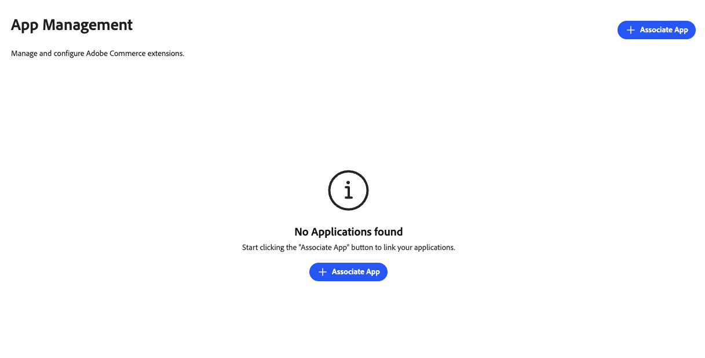
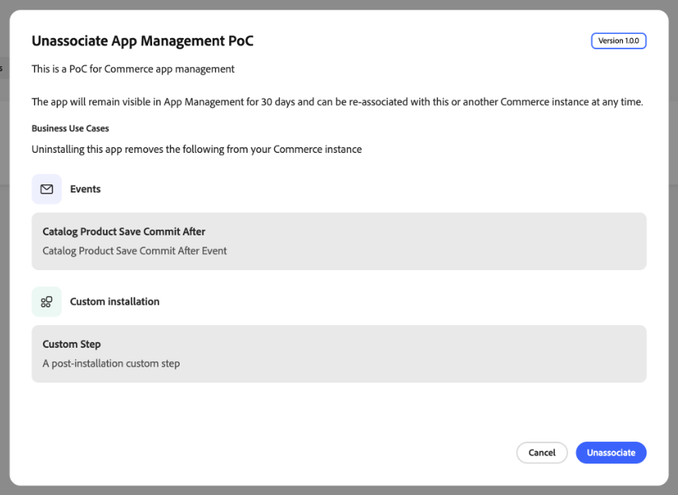

# Gestion de l’application

Utilisez [!DNL App Management] pour associer, installer, configurer, mettre à niveau et dissocier des applications App Builder de votre instance Commerce. Les formulaires de configuration sont générés à partir du schéma de chaque application. Vous pouvez ainsi gérer les paramètres sans développer d’interface utilisateur d’administration personnalisée.

{width="500" zoomable="yes"}

## Trouver une application dans l’Admin

Sous **[!UICONTROL Apps]** > **[!UICONTROL App Management]**, chaque application s’affiche sous la forme d’une carte. La liste peut inclure chaque application associée à l’instance Adobe Commerce pour l’organisation Adobe IMS sélectionnée. Utilisez les commandes situées au-dessus des cartes pour limiter les résultats :

| Contrôle | Description |
| --- | --- |
| **[!UICONTROL Filter by app...]** | Effectuez une recherche par nom d’application. |
| **[!UICONTROL Status]** | Limiter les cartes par état du cycle de vie. **[!UICONTROL All Statuses]** affiche chaque application ; les autres valeurs incluent **[!UICONTROL Associated]**, **[!UICONTROL Installed]**, **[!UICONTROL Partially Installed]** et **[!UICONTROL Unassociated]**. Le statut de chaque carte correspond à l’indicateur coloré de la liste. |
| **[!UICONTROL Extensibility patterns]** | Limitez les cartes en fonction des fonctionnalités utilisées par l’application. **[!UICONTROL All Extensibility Patterns]** affiche chaque application ; les autres valeurs correspondent aux badges de chaque carte, telles que **[!UICONTROL Business Configuration]**, **[!UICONTROL Admin UI SDK]**, **[!UICONTROL Webhooks]** et **[!UICONTROL Events]**. |

Le champ de recherche et les deux filtres s’appliquent ensemble. Pour afficher à nouveau la liste complète, effacez le champ de recherche et sélectionnez **[!UICONTROL All Statuses]** et **[!UICONTROL All Extensibility Patterns]**.

### Consulter les détails de la demande

Sur la vignette de l’application, sélectionnez **[!UICONTROL Manage]** > **[!UICONTROL Details]** pour consulter son nom, sa description et sa version. La boîte de dialogue propose deux onglets :

* **[!UICONTROL Details]** répertorie les cas d’utilisation commerciale de l’application, y compris les événements et les étapes d’installation personnalisées. Consultez les libellés et descriptions pour comprendre ce que l’application ajoute à Commerce.
* **[!UICONTROL App config]** affiche la configuration de l’application au format JSON pour inspection.

{width="600" zoomable="yes"}

{width="600" zoomable="yes"}

## Acquérir l’application

**[!UICONTROL Acquire App]** ouvre un nouvel onglet du navigateur (ou une vue de navigateur distincte) dans [Adobe Exchange](https://exchange.adobe.com/apps/browse/ec){target="_blank"}, où vous pouvez découvrir les listes de la marketplace liées à Commerce et ajouter des applications à votre organisation Adobe IMS. Une fois l’application acquise, approuvée et déployée, elle apparaît en [!DNL App Management] pour [association](#associate-an-app) et [installation](#install-an-app).

## Conditions préalables

Avant d’associer une application, vérifiez que vous disposez des éléments suivants :

| Exigence | Description |
| --- | --- |
| **Accès administrateur** | Administrateur Commerce avec autorisations [!DNL App Management] |
| **Application déployée** | Application App Builder déployée dans votre organisation et prête à se connecter |
| **Accès à l’organisation** | Accès à l’organisation Adobe sur laquelle l’application est déployée |

## Tutoriel

Regardez cette vidéo pour savoir comment associer une application à une instance Commerce et configurer des paramètres.

>[!VIDEO](https://video.tv.adobe.com/v/3478944)

## Associer une application

Le processus d’association importe des sites web, des boutiques et des vues de boutique depuis Commerce et crée le lien entre l’application et votre instance Commerce.

Pour lier votre application App Builder à une instance Commerce :

1. Accédez à **[!UICONTROL Apps]** > **[!UICONTROL App Management]**.

1. Cliquez sur **[!UICONTROL Associate App]**.

   {width="500" zoomable="yes"}

1. Sélectionnez un **[!UICONTROL Project]** dans la liste.

1. Sélectionnez le **[!UICONTROL Workspace]**.

1. Cliquez sur **[!UICONTROL Associate]**.

   {width="500" zoomable="yes"}

>[!WARNING]
>
>Si la synchronisation de la portée échoue, l’association se termine toujours. Vous pouvez synchroniser les portées manuellement ultérieurement à partir de la vue **[!UICONTROL Manage Scopes]** dans la configuration de l’application associée.

## Installation d’une application

L’association lie une application à votre instance Commerce. Pour les applications qui incluent des composants installables, tels que des événements, des Webhooks, des extensions de l’interface utilisateur d’administration ou des étapes d’installation personnalisées, l’installation applique ces composants à l’instance.

1. Ouvrez la boîte de dialogue d’installation de l’application associée dans [!DNL App Management].

1. Examinez les cas d’utilisation commerciale de l’application et les étapes d’installation répertoriées.

1. Si **[!UICONTROL Pre Installation Instructions]** s’affichent, remplissez ces conditions préalables avant de continuer.

   {width="600" zoomable="yes"}

1. Cliquez sur **[!UICONTROL Install]**.

1. Surveillez les indicateurs de progression de chaque élément jusqu’à la fin de l’installation.

   {width="600" zoomable="yes"}

   >[!WARNING]
   >
   >Gardez la page ouverte jusqu’à la fin de l’installation. La fermeture ou l’actualisation de la page peut empêcher l’installation de se terminer correctement.

1. Vérifiez que **[!UICONTROL Successfully Installed]** est affiché et que les éléments terminés comportent des coches.

   {width="600" zoomable="yes"}

1. Suivez les instructions de post-installation fournies par l’application, puis [configurez ses paramètres](#configure-settings) si nécessaire.

## Configurer les paramètres

Après avoir associé une application dans la vue [!DNL App Management], configurez ses paramètres via le formulaire :

1. Sur la vignette de l’application associée, sélectionnez **[!UICONTROL Manage]** > **[!UICONTROL Configure]**.

Le formulaire affiche les paramètres configurables de l’application.

1. Modifiez les valeurs selon vos besoins.

1. Cliquez sur **[!UICONTROL Save]**.

### Configuration spécifique à la portée

Utilisez une configuration spécifique à la portée lorsque différents sites web, magasins ou vues de magasin ont besoin de paramètres uniques. Par exemple, activez une fonctionnalité uniquement pour une zone géographique ou une vue de boutique spécifique, ou utilisez différents paramètres par marque. Les paramètres d’une portée inférieure remplacent ceux des portées supérieures.

Pour remplacer des valeurs globales à un niveau de portée spécifique :

1. Cliquez sur **[!UICONTROL Change Scope]**.

1. Sélectionnez une étendue dans la liste.

1. Modifiez les valeurs pour cette étendue.

1. Cliquez sur **[!UICONTROL Save]**.

## Gérer les portées

Accédez aux **[!UICONTROL Manage Scopes]** à partir de l’écran des détails de l’application pour gérer la hiérarchie de l’étendue de votre application.

{width="500" zoomable="yes"}

| Action | Description |
| --- | --- |
| **[!UICONTROL Add root scope]** | Ajoutez une portée qui s’applique uniquement à l’application. |
| **[!UICONTROL Sync Commerce scopes]** | Actualisez la liste des sites web, des boutiques et des affichages de boutique à partir de Commerce après les avoir ajoutés ou modifiés. |
| **[!UICONTROL Import scopes]** | Importer les portées en bloc depuis un fichier. |

## Mise à niveau d’une application

Lorsque le développeur d’une application déploie une nouvelle version d’une application installée, [!DNL App Management] est averti qu’une mise à niveau est disponible. Le déploiement d’App Builder et une mise à niveau de la gestion des applications sont des opérations distinctes : la mise à niveau applique les modifications planifiées aux composants installés, tels que les événements, les webhooks et les extensions de l’interface utilisateur d’administration.

Demandez à votre développeur d’application de confirmer que l’application prend en charge les mises à niveau. Pour connaître les conditions préalables et les exigences de migration de SDK, voir [Mettre à niveau votre application](https://developer.adobe.com/commerce/extensibility/app-management/upgrade-app/){target="_blank"} dans la documentation destinée aux développeurs.

### Vérifier et démarrer une mise à niveau

En mode manuel, qui est le mode par défaut, vous vérifiez et commencez la mise à niveau en [!DNL App Management].

1. Enregistrez la version et la configuration de l’application installée, puis sauvegardez les données de l’application et les ressources externes avec l’aide de votre développeur d’application.

1. Accédez à **[!UICONTROL Apps]** > **[!UICONTROL App Management]** et ouvrez la mise à niveau disponible pour l’application.

1. Examinez les modifications prévues et les avertissements éventuels. Une mise à niveau peut ajouter, modifier ou supprimer des composants. Si une étape d’installation personnalisée est supprimée, son script de désinstallation ne s’exécute pas et les ressources qu’il a créées ne sont pas automatiquement nettoyées. Vérifiez auprès du développeur ou de la développeuse de l’application que le nettoyage est nécessaire avant de continuer.

1. Démarrez la mise à niveau et surveillez la progression des opérations répertoriées.

1. Consultez les résultats de la mise à niveau et recherchez les opérations ayant échoué. Si la mise à niveau échoue, suivez [La mise à niveau échoue](troubleshooting.md#upgrade-fails) avant d’utiliser **[!UICONTROL Retry Upgrade]**.

En mode manuel, les modifications planifiées apportées aux composants Commerce installés ne sont pas appliquées tant que vous n’avez pas commencé la mise à niveau. Cependant, le déploiement peut mettre à jour le code d’action d’exécution que l’application installée utilise déjà avant l’exécution de la mise à niveau.

### Mises à niveau automatiques

Le développeur d’applications contrôle le mode de mise à niveau. Demandez à votre développeur de confirmer si l’application utilise des mises à niveau manuelles ou automatiques.

>[!WARNING]
>
>Les mises à niveau automatiques sont expérimentales et démarrent après le déploiement sans examen par l’administrateur, y compris les scripts d’installation personnalisés qui peuvent modifier les ressources externes. Contactez votre développeur ou développeuse avant l’activation des mises à niveau automatiques, y compris lorsqu’une nouvelle version déployée change le mode de manuel en automatique.

### Modifications de la configuration d’entreprise

Les modifications apportées au schéma de configuration d’entreprise de l’application apparaissent automatiquement après le déploiement. Ils sont distincts de l’installation et des mises à niveau et ne déclenchent pas de mise à niveau de l’application.

## Dissocier une application

Annulez l’association d’une application lorsque vous n’en avez plus besoin connectée à votre instance Commerce. Par exemple, vous devrez peut-être supprimer une intégration, passer à un autre espace de travail ou nettoyer les configurations de test.

>[!WARNING]
>
>La dissociation supprime toutes les valeurs de configuration pour cette instance. Cette opération ne peut pas être annulée. La désinstallation peut également supprimer des composants et des ressources d’application par le biais de scripts de désinstallation personnalisés.

Avant de continuer, enregistrez la version et la configuration installées, sauvegardez les données de l&#39;application et demandez à votre développeur d&#39;application quelles ressources les scripts de désinstallation de l&#39;application suppriment et qui nécessitent un nettoyage manuel. Planifiez toute interruption de service et apprenez à restaurer l’application, ses paramètres et ses données. Pour les mises à jour de routine, [mettez à niveau l’application](#upgrade-an-app) au lieu de la dissocier.

Pour supprimer une application d’une instance Commerce :

1. Accédez à **[!UICONTROL Apps]** > **[!UICONTROL App Management]**.

1. Sur la vignette de l’application, sélectionnez **[!UICONTROL Manage]** > **[!UICONTROL Unassociate]**.

1. Passez en revue les cas d’utilisation professionnels répertoriés et les composants affectés par la désinstallation, y compris les événements et les étapes d’installation personnalisées.

   {width="600" zoomable="yes"}

1. Confirmez l’action.

## Documentation connexe

* [Dépannage [!DNL App Management]](troubleshooting.md) - Résolvez les problèmes courants liés à l’association, l’installation, la configuration et les mises à niveau.
* [Mise à niveau de l’application](https://developer.adobe.com/commerce/extensibility/app-management/upgrade-app/){target="_blank"} - Exigences du développeur pour les modes de mise à niveau, les scripts de migration et les diagnostics.
