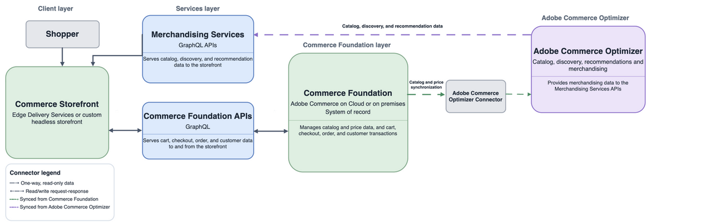

# Options d’architecture d’implémentation

Les architectures d’implémentation d’Adobe Commerce combinent trois couches : un serveur principal de commerce ([!DNL Adobe Commerce] ou [!DNL Adobe Commerce Optimizer]), un storefront et un ensemble de services et d’intégrations connectés. Comparez les options suivantes pour identifier le système propriétaire du catalogue, de la tarification, du panier, de la commande, des commandes et des transactions client dans chaque architecture.

## Résumé des options d’architecture

Comparez les options par propriété de transaction et par expérience storefront.

### Plateforme et transactions Commerce

| Option | Système d&#39;enregistrement | Chemin de la transaction | Ajustement optimal |
| --- | --- | --- | --- |
| **[!DNL Adobe Commerce as a Cloud Service]avec Commerce Foundation** | Adobe-managed Commerce Foundation | Managed Commerce Foundation et services Commerce connectés | Les clients qui souhaitent un Commerce SaaS (Software as a Service) géré par Adobe avec une propriété d’infrastructure réduite |
| **[!DNL Adobe Commerce]sur le cloud ou sur site avec le[!DNL Adobe Commerce Optimizer Connector]** | Commerce Foundation existant, pour les données et transactions Commerce | API Commerce Foundation existantes et services de transaction connectés | Les clients qui souhaitent ajouter des fonctionnalités de découverte et de marchandisage Optimizer à un déploiement [!DNL Adobe Commerce] existant |
| [!DNL Adobe Commerce Optimizer] autonome avec serveur principal de commerce externe **** | Plateforme commerciale existante ou tierce. Les données de catalogue et de prix sont ajoutées à Optimizer à partir d’une source externe | Le maillage API, App Builder ou les intégrations directes connectent le storefront à des services tiers de panier, de passage en caisse, client, de commande, de paiement, de taxe, d’expédition et d’exécution | Clients qui souhaitent bénéficier des fonctionnalités d’Optimizer tout en conservant une plateforme commerciale transactionnelle existante ou tierce |
| **[!DNL Adobe Commerce]sur le cloud ou sur site avec Commerce Foundation** | Commerce Foundation | API Commerce Foundation et intégrations configurées pour les paiements, les taxes, l’expédition, les stocks et l’exécution | Clients qui ont besoin de la plateforme [!DNL Adobe Commerce] complète avec contrôle du déploiement sur le cloud ou l’infrastructure locale |

### Expérience Storefront

Les storefronts se connectent aux API Commerce Foundation, aux services Storefront ([!DNL Catalog Service], [!DNL Live Search] et [!DNL Product Recommendations]) ou aux services de marchandisage [!DNL Adobe Commerce Optimizer].

| Option | Expérience Storefront | Chemin d’accès aux données du storefront |
| --- | --- | --- |
| **[!DNL Adobe Commerce as a Cloud Service]avec Commerce Foundation** | Commerce Storefront optimisé par Edge Delivery Services ou une autre expérience découplée prise en charge | Services Storefront, et API Commerce Foundation pour les données de plateforme principales |
| **[!DNL Adobe Commerce]sur le cloud ou sur site avec le[!DNL Adobe Commerce Optimizer Connector]** | Edge Delivery Services ou storefront découplé personnalisé à l’aide d’expériences Optimizer | API GraphQL des services de marchandisage Commerce Optimizer pour les données de catalogue et de marchandisage gérées par Optimizer |
| [!DNL Adobe Commerce Optimizer] autonome avec serveur principal de commerce externe **** | Commerce Storefront optimisé par Edge Delivery Services ou un storefront découplé personnalisé | API GraphQL des services de marchandisage Commerce Optimizer pour les données de catalogue et de marchandisage |
| **[!DNL Adobe Commerce]sur le cloud ou sur site avec Commerce Foundation** | Edge Delivery Services, Luma, PWA ou storefront découplé personnalisé | API Commerce Foundation et services Storefront lors de leur configuration |

## Adobe Commerce as a Cloud Service

{width="600" zoomable="yes"}

**Limite de clé** : Adobe gère la plateforme Commerce Foundation. L’architecture utilise les services Storefront, notamment [!DNL Catalog Service], [!DNL Live Search] et [!DNL Product Recommendations], pour les expériences de storefront. [!DNL Product Visuals] optimisé par AEM Assets est une intégration SaaS facultative. Voir [Intégration d’AEM Assets pour Commerce](../aem-assets/aem-assets-integration.md).

**Références:**

- [Vue d’ensemble des [!DNL Adobe Commerce as a Cloud Service]](/help/cloud-service/overview.md)
- [Commerce Storefront](https://experienceleague.adobe.com/en/tools/commerce-storefront/)
- [Schéma GraphQL de Storefront Services](https://developer.adobe.com/commerce/webapi/graphql/schema/storefront-services/)

## Adobe Commerce avec Commerce Foundation

{width="600" zoomable="yes"}

**Limite de clé** : Commerce Foundation est propriétaire de la plateforme Commerce et des flux de transactions. [!DNL Catalog Service], [!DNL Live Search] et [!DNL Product Recommendations] offrent un accès storefront optimisé au catalogue, à la recherche et aux recommandations lors de leur configuration. L’intégration d’AEM Assets est facultative. Voir [Intégration d’AEM Assets pour Commerce](../aem-assets/aem-assets-integration.md).

**Références:**

- [Commerce Storefront](https://experienceleague.adobe.com/en/tools/commerce-storefront/)
- [API COMMERCE GRAPHQL](https://developer.adobe.com/commerce/webapi/graphql/)
- [Schéma GraphQL de Storefront Services](https://developer.adobe.com/commerce/webapi/graphql/schema/storefront-services/)

## Adobe Commerce avec le connecteur Optimizer

{width="600" zoomable="yes"}

**Limite de clé** : le connecteur synchronise les données de catalogue et de prix de [!DNL Adobe Commerce] à [!DNL Adobe Commerce Optimizer]. [!DNL Adobe Commerce] reste le système de transactions, tandis qu’Optimizer fournit des expériences de découverte et de marchandisage par le biais de ses API de services de marchandisage.

**Références:**

- [Intégrations Commerce Optimizer](/help/optimizer/integrations/integrations-overview.md)
- [Services de marchandisage Commerce Optimizer](https://developer.adobe.com/commerce/services/optimizer/merchandising-services/)
- [API COMMERCE GRAPHQL](https://developer.adobe.com/commerce/webapi/graphql/)
- [Commerce Storefront](https://experienceleague.adobe.com/en/tools/commerce-storefront/)

## Commerce Optimizer autonome avec un serveur principal tiers

{width="800" zoomable="yes"}

**Limite clé** : le [!DNL Adobe Commerce Optimizer] autonome possède les expériences de découverte de catalogues et de marchandisage, mais pas le serveur principal Commerce transactionnel. Saisie des données de catalogue et de prix via l’API REST Data Ingestion. Le storefront Edge Delivery Services utilise les API GraphQL des services de marchandisage pour les expériences produit et se connecte au serveur principal tiers pour le panier et le passage en caisse.

**Références:**

- [Qu’est-ce que Adobe Commerce Optimizer ?](/help/optimizer/overview.md)
- [Commerce Optimizer Data Ingestion](https://developer.adobe.com/commerce/services/optimizer/data-ingestion/)
- [Services de marchandisage Commerce Optimizer](https://developer.adobe.com/commerce/services/optimizer/merchandising-services/)
- [Commerce Storefront](https://experienceleague.adobe.com/en/tools/commerce-storefront/)

## Référence rapide de terminologie

| Terme préféré | Signification | Évitez d’utiliser comme libellé d’architecture actuel |
| --- | --- | --- |
| **Commerce Foundation** | Fonctionnalités commerciales et transactionnelles de base | Core Commerce, Couche de base PHP |
| **Services Storefront** | API orientées magasin pour le service de catalogue, la recherche en direct et les recommandations de produits | Un libellé limité à une seule plateforme Commerce |
| **Services de marchandisage** | API Optimizer pour la découverte de catalogues et les expériences de marchandisage | API Commerce Foundation |
| **Commerce Storefront avec Edge Delivery Services** | Implémentation du storefront face au client | Une famille d’API |

## Conseils connexes

- [Architectures de référence](reference-architectures.md)
- [Choisir une option Commerce](../portfolio/choose-commerce-option.md)
- [Storefronts](../storefronts/overview.md)
- [API](../apis/commerce-apis.md)
