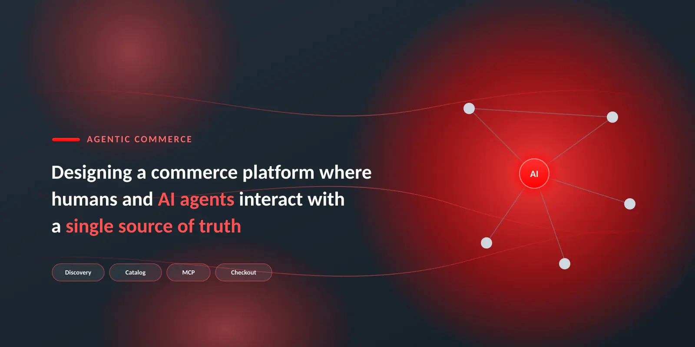

# Concevoir une plateforme commerciale pour les acheteurs et les agents d’IA

<table style="table-layout:auto">
<tr style="border: 0;">
   <td valign="middle" style="vertical-align: middle;"> <strong>Surya Lamech</strong> <em>Responsable principale du marketing produit</em></td>
</tr>
</table>

*Concevoir une plateforme commerciale où les humains et les agents de l&#39;IA interagissent avec une seule source de vérité.*

Commerce est en pleine mutation structurelle. Les clients ne comptent plus uniquement sur les moteurs de recherche ou la navigation sur les vitrines pour explorer leurs options. Au lieu de cela, ils se tournent vers des interfaces optimisées par LLM, des assistants basés sur le chat et des outils d&#39;achat agentiques pour poser des questions, comparer les produits entre les détaillants et accélérer les prises de décision à un stade précoce.

Ces interfaces sont de puissants moteurs de découverte, d’éducation et de comparaison. Ils aident les clients à clarifier les besoins, à évaluer les compromis et à limiter les choix plus rapidement que la navigation traditionnelle.

Pourtant, quand vient le temps de finaliser un achat, les clients préfèrent toujours largement les vitrines de confiance et les sites de marque où la sécurité des paiements, la transparence de l&#39;exécution et le service après-achat sont bien compris. La conversion reste ancrée dans les environnements où la confiance a déjà été établie.

Il est important de noter que l&#39;IA ne disparaît pas à ce stade. Lorsque les clients accèdent à la vitrine d&#39;une marque, l&#39;IA dédiée aux agences peut améliorer l&#39;expérience en guidant la sélection de produits, en personnalisant les recommandations en temps réel, en répondant aux objections, en regroupant les éléments complémentaires et en rationalisant le passage en caisse. Dans ces environnements approuvés, l’IA devient un accélérateur de conversion, améliorant les taux d’achèvement et la valeur moyenne des commandes.

Pour être compétitives dans ce nouveau paysage, les entreprises ont besoin d’une base commerciale **structurée, gouvernée et optimisée pour la consommation humaine et celle des agents**. Adobe Commerce est conçu pour cette évolution. Les principes présentés ci-dessous expliquent ce qu’il faut faire pour être réellement prêt à intervenir sur les agents.

## Architecture de commerce conçue pour deux audiences

{width="800" zoomable="yes"}

*Ce que voient les clients et ce que consomment les agents reste cohérent, précis et intégré à la marque.*

La pile commerciale moderne doit maintenant desservir deux audiences tout aussi importantes : les personnes et les agents d&#39;IA. Les expériences en contact direct avec les utilisateurs comme les storefronts et les applications restent essentielles pour l’engagement, l’expression de la marque et la fidélisation de la clientèle. Mais à côté d&#39;eux se trouve une surface en expansion rapide face à l&#39;agent : des points d&#39;entrée lisibles par machine qui fournissent aux LLM et aux agents autonomes des faits structurés, du contenu régi et des capacités transactionnelles.

Les agents obtiennent de meilleures performances lorsqu’ils utilisent des données propres et structurées, fournies par le biais d’API prévisibles, plutôt que d’essayer d’interpréter JavaScript ou d’inférer des règles métier à partir des couches de présentation. Cela signifie que les spécifications du produit, le prix, la disponibilité et la logique promotionnelle doivent exister en tant que ressources adressables exposées par le biais d’API et d’interfaces normalisées telles que les serveurs MCP. Lorsque les surfaces destinées aux humains et aux agents proviennent de la même source de vérité sous-jacente, les marques s’assurent que ce que les clients voient et ce que les agents consomment restent cohérents, précis et intégrés à la marque.

Cette architecture à double surface est la base du commerce agentique.

## Un catalogue conçu pour le raisonnement automatique

{width="800" zoomable="yes"}

*Une seule source de vérité régie, mise en forme par canal sans jamais dupliquer les données de produit.*

Le catalogue est le cœur du commerce d’agence. Il doit être structuré pour les machines, régi par la conformité et suffisamment flexible pour prendre en charge l’ensemble des interactions humaines et agents. Le modèle de catalogue Adobe Commerce construit autour de vues de catalogue, de politiques, de couches et d’entités de produit structurées est conçu pour cet avenir.

Les vues catalogue définissent où et comment les données de produit sont exposées, que ce soit à un storefront, un marketplace, un flux de partenaire ou une surface d’IA. Chaque vue peut comporter ses propres règles de disponibilité des produits, de tarification et de visibilité des attributs, afin que les informations appropriées parviennent au client ou à l’agent approprié. Les calques de catalogue vous permettent d’enrichir les données de produit pour des canaux spécifiques sans modifier les données de produit source. Les politiques régissent l’éligibilité des clients, la logique de stock, les prix et les contraintes de conformité. Combinées, les entreprises contrôlent précisément les données de catalogue auxquelles un agent peut accéder ou sur lesquelles il peut agir.

## Les MCP comme langage commun pour les agents

{width="800" zoomable="yes"}

*MCP normalise la manière dont les agents demandent des actions dans l’intention naturelle, et Adobe Commerce les effectue en tant qu’actions gouvernées et déterministes.*

Pour qu’Agentic Commerce fonctionne de bout en bout, les plateformes d’e-commerce doivent prendre en charge des protocoles normalisés qui permettent aux agents d’exécuter des actions en toute sécurité, telles que la création de panier, le lancement du passage en caisse, l’orchestration des paiements, la validation des stocks, les promotions et les retours.

Grâce à la prise en charge native de Model Context Protocol (MCP), Adobe structure et expose les fonctionnalités commerciales de manière à ce que les gestionnaires de contenu locaux puissent les interpréter de manière cohérente. Le MCP normalise la manière dont les données de produit, les règles métier et le contexte transactionnel sont présentés aux LLM, afin que les agents puissent les raisonner de manière fiable tandis que les entreprises conservent la gouvernance et le contrôle. Avec le MCP Commerce, les entreprises peuvent créer des expériences agentiques personnalisées telles que des assistants d’achat, la création de panier d’agent, des agents d’assistance, etc.

Le Developer MCP offre des fonctionnalités de développement optimisées par l’IA qui permettent aux équipes d’étendre rapidement les fonctionnalités de la plateforme et de déployer des composants storefront composables. En incorporant les sources de connaissances, la documentation et les bonnes pratiques de plateforme d’Adobe directement dans le workflow de développement, le Developer MCP aide les nouveaux développeurs à s’intégrer plus rapidement et à devenir productifs dès leur premier sprint. Il génère un code qui suit des modèles architecturaux éprouvés, est facile à gérer et répond aux normes de qualité exigées par le commerce d’entreprise. Il en résulte un passage accéléré de l’idée à la production, ce qui permet aux entreprises d’expérimenter, d’itérer et de commercialiser plus rapidement leurs capacités que leurs concurrents.

Adobe s’engage également à prendre en charge les protocoles commerciaux tels que le protocole ACP (Agentic Commerce Protocol) et le protocole UCP (Universal Commerce Protocol), pour permettre la découverte de produits et des interactions transactionnelles sécurisées et normalisées entre les agents et votre storefront.

En adoptant des protocoles ouverts plutôt que des intégrations ponctuelles, Adobe garantit que les interactions commerciales sont régies, déterministes et sécurisées, tout en activant un nouveau modèle d’engagement agent-commerçant où les agents de confiance peuvent effectuer des transactions directement selon des politiques clairement définies.

## Télémétrie et optimisation continue

Dans un écosystème médié par l&#39;IA, la télémétrie devient l&#39;avantage stratégique. Les entreprises ont besoin de visibilité sur la manière dont leur marque est représentée sur les LLM, sur la manière dont les agents représentent précisément leur contenu, sur la manière dont le trafic envoyé par l’agent convertit et sur les endroits où des problèmes de gouvernance ou de conformité surviennent. Ils ont également besoin d’une télémétrie opérationnelle qui suit l’exécution des agents et la détection des anomalies dans les interactions des agents.

Adobe vous donne une visibilité sur l’apparence de vos produits dans LLM, améliore les données de produit avec l’IA et accroît la lisibilité de vos données par LLMS. En ajoutant un contexte significatif à votre catalogue, vous aiderez les entreprises à long terme non seulement à découvrir vos produits avec précision, mais aussi à comprendre ce qu&#39;ils sont, pour qui ils sont et pourquoi ils sont importants pour les clients.

En outre, les pages de détails de vos produits qui ont été optimisées pour la consommation humaine peuvent souvent contenir des données invisibles pour les agents. Ces données peuvent être masquées derrière des modèles, des configurateurs et des pages liées. Les agents peuvent ne pas comprendre entièrement les catégories de produits, les lots et les variantes. Adobe peut identifier ces informations manquantes critiques et les déployer sous la forme d’ID JSON sur Edge afin que les agents puissent obtenir toutes les données de produit appropriées.

Grâce à cette télémétrie et à cette optimisation constantes, les marques peuvent assurer une visibilité maximale et rester compétitives sur l&#39;ensemble des LLM.

## Pourquoi cela est important

Le commerce électronique ne se limite plus aux vitrines et aux résultats de recherche. Les LLM et les agents autonomes servent de médiateurs pour la découverte, l’évaluation et les transactions. Ce changement modifie les mécanismes de visibilité, la dynamique du contrôle et les fondements de la confiance. Les marques gagnantes seront les architectes d’une base native à l’IA.

## Conseils connexes

* [Vues du catalogue](/help/optimizer/setup/catalog-view.md)
* [Calques de catalogue](/help/optimizer/setup/catalog-layer.md)
* [Politiques](/help/optimizer/setup/policies.md)
* [Outils de développement du codage de l’IA pour Adobe Commerce App Builder](/help/cloud-service/migration/coding-tools.md)
* [API COMMERCE](../../apis/commerce-apis.md)
* [Liste de lecture de l&#39;agent de développement Commerce &#x200B;](https://experienceleague.adobe.com/en/playlists/commerce-developer-agent)—Regardez des vidéos techniques sur la configuration et l&#39;utilisation de l&#39;agent de développement Commerce.
