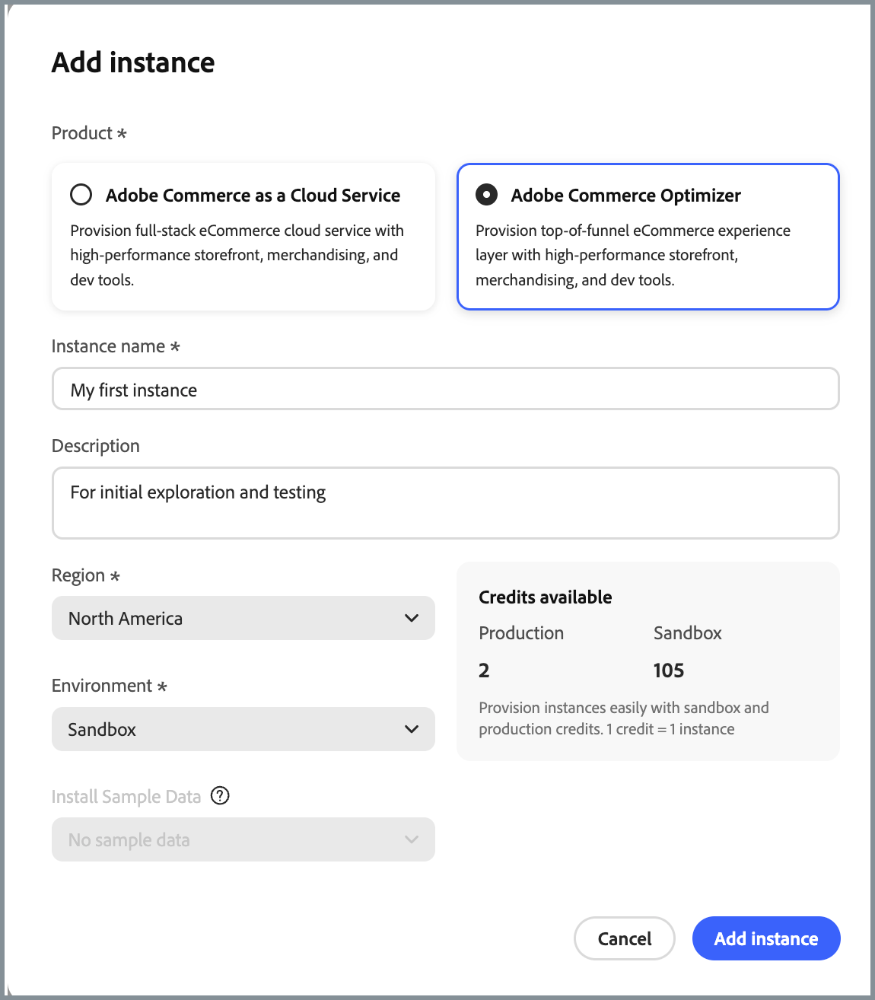

# Notes de mise à jour

Les notes de mise à jour suivantes contiennent des mises à jour de [!DNL Adobe Commerce Optimizer], notamment :

* Nouvelles fonctionnalités et améliorations de [[!DNL Adobe Commerce Optimizer Studio]](overview.md#quick-tour).
* Mises à jour de l’[API REST d’ingestion de données](https://developer.adobe.com/commerce/services/reference/rest/) et de l’[API GraphQL pour la récupération des données du catalogue de storefront](https://developer.adobe.com/commerce/services/reference/graphql/).

  {{aco-api-updates-and-dropins}}

## Novembre 2026

>[!BEGINSHADEBOX]

_2 Novembre 2026_

 **Paramètres régionaux du filtre de recommandation** : clarification du fait que la liste d’attributs utilise la source de catalogue associée à la première vue de catalogue lorsque vous sélectionnez **[!UICONTROL All Views]**. Voir [Filtres de recommandation](./merchandising/recommendations/filters.md).

_6 Novembre 2026_

 **Intégrations de panier et de passage en caisse tiers**—Ajout de conseils sur l’intégration de services de panier et de passage en caisse tiers à [!DNL Adobe Commerce Optimizer]. Voir [Intégrations](./integrations/integrations-overview.md#third-party-cart-and-checkout-integration).

 **Stockage des visualisations de produit** : clarification du fait que vous pouvez augmenter la capacité de stockage de [!DNL Product Visuals] en mettant à niveau votre licence [!DNL AEM Assets]. Voir [Limites et limites](./boundaries-limits.md#product-visuals-limits).

 **Conseils de configuration d’AEM Assets** : suppression du flux de configuration [!DNL Adobe Commerce Optimizer] autonome pour [!DNL AEM Assets] et redirection des conseils de configuration vers la documentation générale sur la configuration [!DNL AEM Assets]. Voir [Intégrations](./integrations/integrations-overview.md#product-visuals), [Couches de catalogue](./setup/catalog-layer.md) et [Visuels de produit](./setup/product-visuals.md).

 **clé de référence de recommandation**—Documentation de **[!UICONTROL Reference Key]** comme alternative à l’ID de recommandation lorsque vous configurez un bloc de recommandations de storefront. Voir [Créer et gérer des recommandations](./merchandising/recommendations/create.md#get-the-storefront-reference-key).

_16 Novembre 2026_

 **Capacité de la facette**—Documentation indiquant que vous pouvez augmenter la limite de facette par le biais d’une demande du service clientèle. Voir [Limites et limites](./boundaries-limits.md#catalog-views-and-policies).

{{aco-release}}

>[!ENDSHADEBOX]

## Octobre 2026

>[!BEGINSHADEBOX]

_1Er Octobre 2026_

 **Vues de catalogue partagé B2B**—Documentation sur la manière dont les catalogues partagés B2B peuvent être configurés automatiquement en tant que vues de catalogue privé, avec l’option de configuration manuelle pour d’autres cas d’utilisation. Il a également été précisé que la rotation de clés d’accès restreint n’est pas automatisée. Voir [Vues de catalogue privé](./setup/private-catalog-view.md), [Clés d’accès restreintes](./setup/restricted-access-keys.md), [Synchronisation des données](./setup/data-sync.md) et la [liste de contrôle de lancement](./launch/launch-checklist.md).

_12 Octobre 2026_

 **Filtre de recommandation de rupture de stock** : ajout du filtre d’exclusion de rupture de stock, qui vous permet d’empêcher l’affichage des produits en rupture de stock dans les unités de recommandation. Voir [Filtres de recommandation](./merchandising/recommendations/filters.md#out-of-stock).

_14 Octobre 2026_

 **les valeurs de l&#39;amplification intelligente du classement**—Correction de la valeur par défaut documentée à `50` et de la valeur maximale à `1000`. Voir [Créer et gérer des règles de marchandisage](./merchandising/rules/add.md#intelligent-ranking-boost).

_16 Octobre 2026_

 **Nom de règle de recherche par défaut** : mise à jour du nom de la règle de marchandisage de [!UICONTROL All product listings] vers [!UICONTROL Default search rule] pour qu’il corresponde à l’interface d’administration. Voir [Présentation des règles de marchandisage](./merchandising/rules/overview.md) et [Créer et gérer des règles de marchandisage](./merchandising/rules/add.md).

_21 Octobre 2026_

 **Limites de clé d’accès restreint** : suppression du nombre de clés d’accès restreint par environnement des limites documentées. Voir [Limites et limites](./boundaries-limits.md#catalog-views-and-policies).

_22 Octobre 2026_

 **Filtres d’attribut de recommandation** : ajout de conseils pour l’activation des filtres d’attribut via l’API de métadonnées. Voir [Filtres de recommandation](./merchandising/recommendations/filters.md#attributes).

{{aco-release}}

>[!ENDSHADEBOX]

## Septembre 2026

>[!BEGINSHADEBOX]

_3 Septembre 2026_

### Classement des attributs (version bêta)

Les règles de marchandisage [!DNL Adobe Commerce Optimizer] prennent désormais en charge le [**classement des attributs**](./merchandising/rules/add.md#attribute-ranking) pour la **règle de recherche par défaut**, la **règle de catégorie** et la **règle de recherche**. Appliquez automatiquement une action **[!UICONTROL Boost]**, **[!UICONTROL Bury]** ou **[!UICONTROL Hide]** à chaque produit qui correspond à une ou plusieurs conditions d’attribut, telles que la marque ou la catégorie, sans sélectionner de SKU individuels. Le classement des attributs est en version Beta. [En savoir plus](./merchandising/rules/add.md#attribute-ranking).

_9 Septembre 2026_

 **Politiques de déclenchement d’en-tête HTTP à plusieurs valeurs**—Les politiques de déclenchement utilisant le type de transport `HTTP_HEADER` peuvent désormais recevoir plusieurs valeurs séparées par des virgules dans un seul en-tête (par exemple, `AC-Policy-Vehicle: UNIVERSAL,veh-bolt-mammoth-limited-2025`). Les filtres de politique utilisant `IN` évaluent les valeurs avec la sémantique `OR`. Les filtres utilisant `EQUALS`, `GREATER_THAN_EQUAL` ou `LESS_THAN_EQUAL` rejettent la requête avec une erreur de validation si l’en-tête contient plusieurs valeurs. Ce comportement s’applique uniquement aux politiques de déclenchement utilisant le transport `HTTP_HEADER`. [En savoir plus](./setup/policies.md#multi-value-http-header-triggers).
<!--COMOPT-2439-->

{{aco-release}}

>[!ENDSHADEBOX]

## Août 2026

>[!BEGINSHADEBOX]

_7 Août 2026_

 **Nouveau champ `externalIds`**—Ajouté `externalIds` au GraphQL du service de catalogue, exposant la source de données externe associée à un produit afin que les clients du storefront et de l’intégration puissent identifier la source de données d’origine. Voir [Renvoyer les externalIds pour un produit](https://developer.adobe.com/commerce/services/optimizer/merchandising-services/use-cases#return-external-ids-for-a-product){target="_blank"}
<!--DATA-7307-->

 **Réponse `refineProduct` correcte pour les produits configurables** : correction d’un problème en raison duquel la requête `refineProduct` renvoyait `priceRange: null` et `roles: ["hidden"]` pour des produits configurables spécifiques, garantissant ainsi des informations de prix et de visibilité précises pour les consommateurs storefront.
<!--COMOPT-2367-->

{{aco-release}}

>[!ENDSHADEBOX]

## Juillet 2026

>[!BEGINSHADEBOX]

_20 Juillet 2026_

 **Performances de navigation par catégorie** : application d’optimisations de performances au service de catégorie, ce qui se traduit par un débit plus élevé et une latence P99 plus faible pour la requête `CategoryNavigation`, ce qui améliore la réactivité du service et l’expérience utilisateur globale sous une charge élevée.
<!--DATA-7131 DATA-7250-->

{{aco-release}}

>[!ENDSHADEBOX]

## Juin 2026

>[!BEGINSHADEBOX]

_24 Juin 2026_

<!-- v1.3 -->

 **Nouveau champ `canEditQuantity`**—Ajouté `canEditQuantity` à `ProductViewOptionValueProduct` dans le GraphQL du service de catalogue. Il expose le paramètre de quantité facultatif **défini par l’utilisateur** pour les sélections de bundle effectuées par l’administrateur Commerce, afin que les consommateurs du storefront puissent déterminer si la quantité d’une sélection de bundle est modifiable.
<!--COMOPT-2050-->

### Recherche sémantique

[!DNL Adobe Commerce Optimizer] prend désormais en charge la **[recherche sémantique]** dans l’onglet [**Recherche avancée**](./settings.md#advanced-search) de **[!UICONTROL Settings]**. La recherche sémantique utilise l’IA pour faire correspondre les produits par signification et par contexte, ainsi que la recherche par mot-clé, ce qui réduit les pages de recherche vides pour les requêtes en langage naturel. Elle est activée par défaut pour les catalogues anglais éligibles. Vous pouvez éventuellement régler **[!UICONTROL Semantic boost]**, **[!UICONTROL Similarity threshold]** et **[!UICONTROL Fuzzy search]** sur le même onglet. Aucune configuration d’attribut ou modification du storefront n’est requise. [En savoir plus](./setup/semantic-search.md).

### Filtres de prix recommandés (version bêta)

Les unités de recommandation de produit prennent désormais en charge les [**filtres de prix**](./merchandising/recommendations/filters.md#price) à l’étape **[!UICONTROL Filter products]**. Incluez ou excluez des candidats à l’aide de **plages minimales et maximales** ou de **règles dynamiques** sur la page des détails du produit qui comparent les produits recommandés au **prix calculé final** du produit actuellement consulté à partir du catalogue des prix actifs du storefront. Les règles de prix filtrent le jeu de candidats. Ils ne reclassent pas les produits. [En savoir plus](./merchandising/recommendations/filters.md#price).

{{aco-release}}

>[!ENDSHADEBOX]

## Mai 2026

>[!BEGINSHADEBOX]

### Amplification intelligente du classement

Les [règles de marchandisage](./merchandising/rules/add.md#intelligent-ranking-boost) pour la recherche, les listes de produits par défaut et les [pages de catégorie](./merchandising/rules/add.md#rule-types) incluent désormais **[!UICONTROL Intelligent Ranking Boost]**. Vous pouvez ajuster la mesure dans laquelle des stratégies telles que **Les plus consultés** ou **Tendance** influencent l’ordre des produits par rapport à la pertinence textuelle sur la recherche et les signaux comportementaux sur les listes de catégories. L’aperçu des règles reflète vos paramètres. L’amplification est appliquée au moment de la requête. Vous n’avez donc pas besoin d’une resynchronisation du catalogue lorsque vous la modifiez.

### Mises à jour des API

_28 Mai 2026_

<!-- v1.2 -->

 **Arborescences de navigation complètes** : les catégories descendantes balisées sont désormais correctement incluses dans les arborescences `navigation` filtrées par famille lorsqu’un nœud intermédiaire non balisé existe dans le chemin d’accès. Ce correctif garantit que les acheteurs voient toutes les catégories pertinentes dans la navigation, ce qui facilite la navigation et la découverte d’articles.
<!--DATA-7183-->

 **De la gestion des slugs vides dans les `categoryTree` requêtes**—Correction d&#39;un problème où la requête [`categoryTree`](https://developer.adobe.com/commerce/services/reference/graphql/#categorytree) renvoyait une erreur de serveur interne lorsque l&#39;argument `slugs` incluait une chaîne vide. Les valeurs slug vides sont désormais ignorées, de sorte que les storefronts et les intégrations continuent de résoudre les données de catégorie sans requêtes ayant échoué.
<!--DATA-7184-->

 les requêtes **`searchCategory`renvoient des résultats insensibles à la casse et classés par ordre alphabétique**—La requête `searchCategory` trie désormais les résultats de recherche par ordre alphabétique sans respect de la casse, ce qui garantit un ordre cohérent et prévisible. Les catégories comportant des préfixes plus courts apparaissent en premier lorsque les noms sont par ailleurs identiques.
<!--COMOPT-2142-->

_4 Mai 2026_

<!--v1.53-->

**Affichage de la devise correcte** : les prix des produits Storefront affichent désormais le code de devise correct (par exemple, USD) pour tous les types de produits. Auparavant, certains produits affichaient `NONE` au lieu de la devise attendue, ce qui entraînait des prix manquants.

<!--DATA-7115-->

{{aco-release}}

>[!ENDSHADEBOX]

## Avril 2026

**Date de publication** : 7 avril 2026

>[!BEGINSHADEBOX]

### Règles de catalogue

[Les règles de catégorie](./merchandising/rules/add.md) étendent les règles de marchandisage afin que vous puissiez cibler les catégories et contrôler l’ordre des produits sur les pages de catégorie avec le même classement et les mêmes actions (épingler, booster, enterrer) que la recherche.

### Filtre de prix (version bêta)

Les filtres de recommandation incluent désormais un filtre de [gamme de prix](./merchandising/recommendations/filters.md#price) (minimum et maximum).

### Mises à jour des API

_29 Avril 2026_

<!--v1.52 release-->

**Traitement par lots des requêtes obligatoire** — L’API GraphQL applique désormais un maximum de 100 SKU par requête lorsque vous récupérez des données de catalogue. Voir [limites et limites documentées](https://experienceleague.adobe.com/en/docs/commerce/optimizer/boundaries-limits#product-discovery).

<!--DATA-7156-->

_17 Avril 2026_

<!--v1.51 release-->

**Rechercher des catégories par nom avec GraphQL** — La nouvelle requête [`searchCategory`](https://developer.adobe.com/commerce/services/reference/graphql/) renvoie les catégories correspondantes avec pagination pour les storefronts et les intégrations. Voir la référence de l’API pour les paramètres et les champs de réponse. <!--COMOPT-1819-->

_7 Avril 2026_

<!--v1.50 release-->

**Recherches de catégorie simplifiées** — La requête [categoryTree](https://developer.adobe.com/commerce/services/reference/graphql/#categorytree) traite `family` comme étant facultatif, de sorte que vous pouvez résoudre les catégories par slug sans fournir de famille.

{{aco-release}}

>[!ENDSHADEBOX]

## Mars 2026

Aucune version [[!DNL Adobe Commerce Optimizer Studio]](overview.md#quick-tour) n’a été publiée ce mois-ci. Voir les mises à jour des API ci-dessous.

>[!BEGINSHADEBOX]

### Mises à jour des API

_24 Mars 2026_

Les bundles dynamiques renvoient désormais une plage de prix calculée. <!--DATA-7014-->

{{aco-release}}

>[!ENDSHADEBOX]

## Février 2026

**Date de publication** : 19 février 2026

>[!BEGINSHADEBOX]

### Vue Catalogue pour les règles et recommandations de marchandisage

Vous pouvez désormais spécifier une vue de catalogue lorsque vous [créez des unités de recommandation](./merchandising/recommendations/create.md) ou des [règles de marchandisage](./merchandising/rules/add.md).

### Mises à jour des API

_19 Février 2026_

<!--v1.48-->

**Contenu de catégorie plus riche pour les storefronts** — La requête [categoryTree](https://developer.adobe.com/commerce/services/reference/graphql/#categorytree) renvoie désormais des descriptions, des images et des balises META d’optimisation pour les moteurs de recherche afin que les storefronts puissent effectuer le rendu de pages de catégorie plus riches.<!--DATA-6933-->

_12 Février 2026_

<!--v1.49-->

**Amélioration des données de produit par catégorie** — L’API GraphQL ajoute le type [`CategoryProductView`](https://developer.adobe.com/commerce/services/reference/graphql/#categoryproductview){target="blank"} afin que vous puissiez interroger et filtrer les produits par catégorie avec moins d’allers-retours.

{{aco-release}}

>[!ENDSHADEBOX]

## Janvier 2026

Aucune version [[!DNL Adobe Commerce Optimizer Studio]](overview.md#quick-tour) n’a été publiée ce mois-ci. Voir les mises à jour des API ci-dessous.

>[!BEGINSHADEBOX]

### Mises à jour des API

_19 Janvier 2026_

* **Les catégories plus riches sont prises en charge avec les opérations de l’API REST** — [L’API des catégories](https://developer.adobe.com/commerce/services/reference/rest/#operation/createCategories) accepte désormais les valeurs facultatives `metaTags`, `images` et `description` en plus de `families`, ce qui vous permet de fournir des détails de marchandisage et d’optimisation du moteur de recherche plus riches pour les catégories.

{{aco-release}}

>[!ENDSHADEBOX]

## Décembre 2025

**Date de publication** : 10 décembre 2025

>[!BEGINSHADEBOX]

### Opportunités

Les marchandiseurs peuvent désormais obtenir des recommandations optimisées par l’IA via [Adobe Sites Optimizer](./manage-results/opportunities.md) pour détecter les problèmes de site et suggérer des correctifs de performances.

### Calques de catalogue

Les marchandiseurs peuvent désormais utiliser les [couches Catalogue](./setup/catalog-layer.md) pour superposer les données de produit sans modifier le catalogue source, gérer la priorité des couches et utiliser le correctif automatique Adobe Sites Optimizer.

{{aco-release}}

>[!ENDSHADEBOX]

## Novembre 2025

Aucune version [[!DNL Adobe Commerce Optimizer Studio]](overview.md#quick-tour) n’a été publiée ce mois-ci. Voir les mises à jour des API ci-dessous.

>[!BEGINSHADEBOX]

### Mises à jour des API

_21 Novembre 2025_

**Instructions d’authentification mises à jour pour l’API REST d’ingestion de données** — Les instructions font désormais référence aux jetons d’accès OAuth et aux portées d’informations d’identification Developer Console correctes pour le service d’ingestion de données. Si les portées de vos informations d’identification sont obsolètes, régénérez-les pour conserver l’accès.

_3 Novembre 2025_

<!-- v1.43 -->

**Contenu de produit localisé superposé dans GraphQL** — Vous pouvez désormais diffuser du contenu de produit spécifique au canal et prenant en compte les paramètres régionaux à partir de [!DNL Adobe Commerce Optimizer].

* Personnaliser le contenu des produits par segment client
* Appliquer des remplacements spécifiques aux paramètres régionaux sans dupliquer les données du catalogue de base
* Contrôle des remplacements au niveau du champ avec des masques de calque
* Utilisez des calques de contenu premium, saisonniers et optimisés pour les appareils mobiles

Aucun changement de schéma de l’API GraphQL : les calques s’appliquent à travers les en-têtes de requête et de requête `products` existants. Voir [Couche de catalogue](./setup/catalog-layer.md).

{{aco-release}}

>[!ENDSHADEBOX]

## Octobre 2025

**Date de publication** : 14 octobre 2025

>[!BEGINSHADEBOX]

### Connecteur Commerce Commerce Optimizer Salesforce

Le [!DNL Commerce Optimizer Salesforce Commerce Connector] est un nouveau kit de démarrage App Builder qui synchronise les données du catalogue Commerce B2C Salesforce dans [!DNL Commerce Optimizer].<!--COMOPT-536-->

**Pour Les Administrateurs :**

* Les modifications du catalogue Salesforce (produits, prix, métadonnées, livres de prix) sont automatiquement synchronisées avec [!DNL Commerce Optimizer].
* S&#39;exécute en dehors de [!DNL Adobe Commerce] pour moins de points de contact d&#39;intégration.
* Les mises à jour planifiées tiennent les données [!DNL Commerce Optimizer] à jour pour le marchandisage et les recommandations.

**Pour Les Développeurs :**

* Framework extensible pour l’ingestion de catalogues Salesforce dans les services de marchandisage SaaS.
* Référencez des implémentations, des documents de conception et des exemples de code pour accélérer les builds et le dépannage.

### Recherche superposée

* **Recherche superposée (GA)** — La recherche de produits prend désormais en charge la correspondance entre `startsWith` et `contains`. Voir [Recherche en couches et types de recherche étendus](https://developer.adobe.com/commerce/webapi/graphql/schema/live-search/queries/product-search/#layered-search-and-expansion-of-search-types).

### Mises à jour des API

* _17 Octobre 2025_

  **Ajoutez la prise en charge de l’API REST pour ingérer les couches de produit** — Utilisez l’API [Couches de catalogue](https://developer.adobe.com/commerce/services/reference/rest/#tag/Product-Layers) pour personnaliser et remplacer les données de produit de base pour des contextes, des paramètres régionaux ou des besoins commerciaux spécifiques. Après avoir créé des calques, vous pouvez les appliquer et les gérer à partir de [Adobe Commerce Optimizer Studio](./setup/catalog-layer.md).<!--DATA-6632-->

* _14 Octobre 2025_

  **Arborescences de catégories programmatiques** — Créez, mettez à jour et gérez les arborescences de catégories pour la navigation et le regroupement via REST (global ou spécifique à un canal), à grande échelle (jusqu’à 10 000 arborescences et 500 catégories par arborescence). Voir [Catégories](https://developer.adobe.com/commerce/services/reference/rest/#tag/Categories){target="blank"} dans la _Référence de l’API REST d’ingestion des données de catalogue_.<!--DCAT-2649-->

* _8 Octobre 2025_

  **Mappage de catégories plus clair pour l&#39;ingestion de données** — De nouvelles directives expliquent le format et les règles de hiérarchie des slugs de catégorie et précisent que les valeurs du produit `routes.path` doivent correspondre à un slug de catégorie existant (par exemple, `men/clothing`).

{{aco-release}}

>[!ENDSHADEBOX]

## Septembre 2025

Aucune version [[!DNL Adobe Commerce Optimizer Studio]](overview.md#quick-tour) n’a été publiée ce mois-ci. Voir les mises à jour des API ci-dessous.

>[!BEGINSHADEBOX]

### Mises à jour des API

_23 Septembre 2025_

* **Gérer les catégories à l&#39;aide de l&#39;API REST** — Utilisez l&#39;API [Catégories](https://developer.adobe.com/commerce/services/reference/rest/#operation/createCategories) pour créer et gérer des catégories. Les catégories organisent les produits en groupes logiques et prennent en charge les hiérarchies imbriquées par le biais de chemins basés sur des slugs. Après avoir affecté des catégories aux produits, récupérez-les avec les requêtes GraphQL `[navigation](https://developer.adobe.com/commerce/services/reference/graphql/#navigation)` et `[categoryTree](https://developer.adobe.com/commerce/services/reference/graphql/#categorytree)` pour effectuer le rendu des menus de storefront et des arborescences de catégories.<!--DCAT-2626-->

{{aco-release}}

>[!ENDSHADEBOX]

## Août 2025

**Date de publication** : 28 août 2025

>[!BEGINSHADEBOX]

### Région de l’UE désormais disponible

La région de production de l&#39;UE (**eu1**) est disponible pour les organisations IMS. Lorsque vous [ajoutez une [!DNL Commerce Optimizer] instance](./get-started.md#step-1-create-an-instance) dans Cloud Manager, choisissez **[!UICONTROL European Union]** comme **[!UICONTROL Region]** (production uniquement).

Les URL de production de base pour la région de l’Union européenne sont les suivantes :

* Administrateur : `https://eu1.admin.commerce.adobe.com`
* REST et GraphQL : `https://eu1.api.commerce.adobe.com`

{width="600" align="center" zoomable="yes"}

{{aco-release}}

>[!ENDSHADEBOX]
